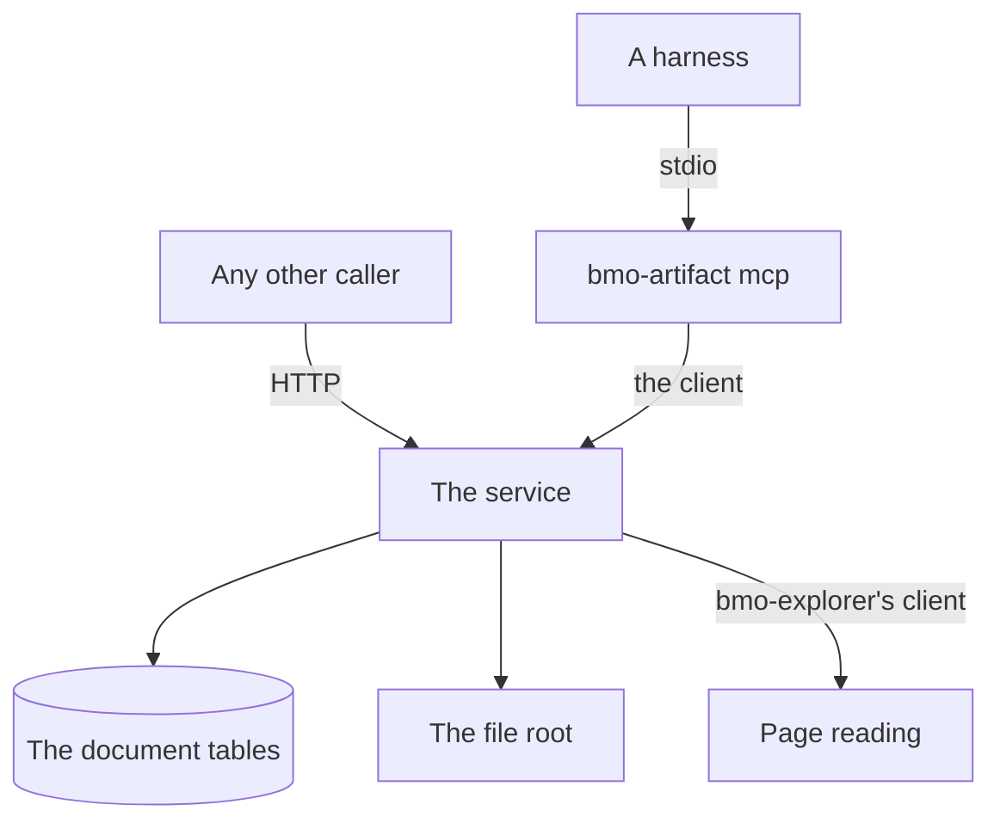

# The boundary: bmo-artifact

bmo-artifact keeps documents, finds them again and shares them by link: records, learning books, imported
pages and HTML pages, each with its body, its attachments, the pages it refers to and its cover picture. It
is an upstream (bmo-chat's `docs/conventions.md`, 「Upstream and downstream」): a harness takes it as its
first entry point through its MCP server, with no console and no other unit running beside it but the page
reader it imports through. It runs no research and speaks no narration: a research run is a client's work
that files its result here, and a narration is a sound a client attaches. This document is the whole of what
it serves and of what it calls; another repository reaches it through nothing else.

## Versioning

- **The repository has one version,** in `VERSION`, the Cargo manifest and the console bundle's package,
  which `GET /health`, the OpenAPI document and the MCP server's `serverInfo` all answer.
- **It is numbered as bmo-chat's `docs/conventions.md` says (「Versions」):** before the first release
  `0.1.0`, then `0.1.0-rev.<n>`, one revision a version bump, whatever the change.

## The wire

- **The wire format is bmo-chat's** (`docs/conventions.md`, 「The common wire format」 and 「API design」):
  camelCase keys, times in epoch milliseconds, ids as signed 64-bit integers, a page as `items` and
  `more`, a failure as a status with `code` and `error`.
- **Every route takes the token** the settings name, as `Authorization: Bearer <token>`. A missing or wrong
  token is refused 401 `unauthorized`; an empty token in the settings lets no caller in.
- **The paths carry no prefix.** Whatever serves the service to a browser mounts it under its own path.
- **A caller's strings are opaque:** `scope` is what a document or an import is held under, `actorName`
  who filed it, and `labels` the caller's own metadata, an object of strings. The service stores and
  matches them and never reads meaning into them.
- **Every answer is English,** a sentence or a status code.
- **`docs/openapi.json` is the contract,** an OpenAPI 3.1 document generated from the service's own types:
  every route with its parameters, bodies, answers and codes, the events under `x-events`, the tools under
  `x-tools`, the plugin under `x-harness` and the units it calls under `x-calls`. A test fails where the
  committed document differs from what the code generates; `bmo-artifact openapi` prints it.

### Codes

| Status | `code` | When |
|---|---|---|
| 400 | `bad-request` | the body, the query or a path key is not the shape the route takes; the sentence names what |
| 401 | `unauthorized` | the token is missing or wrong |
| 404 | `no-route` | no route answers this method and path |
| 404 | `not-found` | nothing stands at the key the path names |
| 409 | `conflict` | the member does not take the change: a body for a page, HTML for any other kind |
| 410 | `gone` | an event stream resumed from before the window the service keeps |
| 413 | `too-large` | the body or an attachment is over its ceiling |
| 500 | `failed` | the service failed: its store or its file root; the sentence is the failure |

### Lists

- **A page is newest first** unless its route says otherwise, at most `limit` items, 30 where none is
  given and 200 at most; a `limit` that is not a whole number from 1 is refused `bad-request`.
- **`before` and `after` are ids:** `before` asks for the members older than the one named, `after` for the
  ones newer. A page answers `more` where something stands past its last item.

## Documents

A document is one row of the document tables and one file under the file root (docs/archive.md, 「Where it
lives」).

| Field | Holds |
|---|---|
| `id` | the document's number |
| `kind` | one of the kinds below |
| `title` | its title |
| `scope` | what it is held under, null where none was given |
| `actorName` | who filed it |
| `labels` | the caller's metadata |
| `description` | what it reads as before it is opened: a page's declared description, else the opening prose of its body as plain words, cut at 160 characters; null where it has none |
| `attachmentCount` | how many files it keeps |
| `createdAt`, `changedAt` | when it was filed and last rewritten |

### Kinds

Each kind is a module of its own answering one shape (docs/archive.md, 「Kinds」); `GET /document-kinds`
lists them in the catalogue's order, each `name`, `description`, `hosted` (whether the document is opened
as the page it keeps) and `contentsDepth` (how many levels of its headings its table of contents lists,
0 for none); its `after` is a kind's place in the catalogue, counted from 1. A row whose kind no module
answers reads as `record`.

| Kind | What it is | Its file |
|---|---|---|
| `record` | data put in order and kept | the markdown body as filed |
| `learning` | study material, a book of parts, chapters and sections | the markdown body as filed |
| `import` | a page brought in whole through `POST /imports` | the markdown the import wrote |
| `page` | an HTML page kept as it stands | the HTML as filed |

### Routes

| Route | Takes | Answers |
|---|---|---|
| `GET /documents` | query `kind?`, `scope?`, `label?`, `q?`, `before?`, `after?`, `limit?` | 200, a page of documents |
| `POST /documents` | `kind`, `title`, `body?`, `html?`, `scope?`, `actorName`, `labels` | 201, the document |
| `GET /documents/{documentId}` | | 200, the document |
| `PATCH /documents/{documentId}` | `title?`, `body?`, `html?`, `labels` | 200, the document |
| `GET /documents/{documentId}/content` | query `scheme?`, `download?` | 200, the file |
| `GET /documents/{documentId}/picture` | | 200, the cover picture as JPEG |
| `GET /document-kinds` | query `after?`, `limit?` | 200, a page of kinds |

- **`GET /documents` filters in the reading itself,** so a filtered page is a full one. `kind` holds it to
  one kind and `scope` to one scope; `label` is `key:value` for documents whose label `key` is `value`, or
  `key` alone for those carrying it; `q`, cut to 200 characters, holds it to documents saying the phrase,
  matched whole and without regard to case in the title, the labels and the body. A blank `q` is no search.
- **`POST /documents` files a document.** `page` takes `html` and nothing in `body`; every other kind takes
  `body` and no `html`. The title is required, except for a page whose own `title` element gives one.
  Each distinct http or https link the body makes becomes one of the document's references. Refused
  `bad-request` for a kind no module answers, an empty title or body, or a body and HTML given the wrong
  way round.
- **`PATCH /documents/{documentId}` rewrites it under its number;** its attachments and share links stay.
  `labels` replaces the labels whole; a `title`, `body` or `html` given replaces that one, and its
  references are read again from a new body. A body for a page or HTML for any other kind is refused
  409 `conflict`.
- **`GET /documents/{documentId}/content`** sends the file: `text/markdown` for a markdown kind, never
  cached. A page goes out as a hosted page (docs/archive.md, 「An HTML page」): its prelude ahead of its
  first element in the scheme `scheme` names, `light`, `dark` or `system`, the design's default where none is named, under the
  sandboxed page policy. `download=true` sends the file itself to keep, under its name. 404 `not-found`
  where the document has no file inside its folder.
- **`GET /documents/{documentId}/picture`** sends the picture a link's preview card shows: the first its
  body draws, else the first it keeps, upright, fitted inside 1200 pixels, never enlarged, laid on white,
  as JPEG. 404 `not-found` where it has none.

## Attachments

| Field | Holds |
|---|---|
| `id`, `documentId` | the attachment and its document |
| `name` | the name it is shown and named by in the body |
| `mediaType` | its type as kept |
| `kind` | what it is read as: `image`, `audio`, `video`, `text`, `page` or `file` |
| `byteCount` | its size |
| `role` | the caller's word for its part in the document, null for none; `head` marks a file a reader is shown at the document's head, a narration's sound among them |
| `createdAt` | when it was kept |

| Route | Takes | Answers |
|---|---|---|
| `GET /documents/{documentId}/attachments` | query `after?`, `limit?` | 200, a page of attachments, in the order they were kept |
| `POST /documents/{documentId}/attachments` | `name`, `mediaType`, `role?`, `content` in base64 | 201, the attachment |
| `GET /documents/{documentId}/attachments/{attachmentId}` | query `scheme?`, `download?`; the `Range` header | 200 or 206, the bytes |

- **A file is kept as docs/archive.md 「Attachments」 says:** its kind read from its bytes and its name, a
  picture kept upright as AVIF, a name the document already keeps refused `bad-request`. One file is at
  most 64 MiB, refused `too-large` past it.
- **The bytes are served** with `Range` answered 206, an HTML file as a hosted page as the content route
  does, and every other file under the policy that lets nothing on it run. `download=true` sends it to
  keep. An attachment of another document is `not-found`.

## References

A reference is a page a document refers to: a link its body makes, the page an import came from, or a
work that page cites.

| Field | Holds |
|---|---|
| `id`, `documentId` | the reference and its document |
| `url` | the page's address |
| `title` | the page's title as the document or its preview gives it, null where neither does |
| `preview` | the description the page declares for a preview, null where it declares none or has not been read |

| Route | Takes | Answers |
|---|---|---|
| `GET /documents/{documentId}/references` | query `after?`, `limit?` | 200, a page of references, in the document's order |
| `GET /documents/{documentId}/references/{referenceId}` | | 200, the reference, its preview read |
| `GET /documents/{documentId}/references/{referenceId}/image` | | 200, the page's preview picture |

- **A preview is read through bmo-explorer's client** (「What this service calls」) and kept under the file
  root: a preview for a week, a picture for a month, a failure for a day. The list answers what is kept; one
  reference read alone reads its preview where none is kept fresh.
- **The image** goes out as the type its bytes are, not sniffed and sandboxed; 404 `not-found` where the
  page declares none or it could not be fetched.

## Share links

A share link opens one document for whoever holds its token. A document has at most one live link.

| Field | Holds |
|---|---|
| `token` | the link's token, 22 to 128 letters, digits, `-` and `_` |
| `documentId` | the document it opens |
| `url` | the share address the settings name, a `/` and the token |
| `createdAt` | when it was made |
| `expiresAt` | when it stops opening, null for a link with no end |

| Route | Takes | Answers |
|---|---|---|
| `GET /shares` | query `documentId?`, `after?`, `limit?` | 200, a page of live links, oldest first; `after` is a `createdAt` |
| `POST /shares` | `documentId`, `expiresAt?` | 201, the link made; 200, the live link that already stands |
| `GET /shares/{token}` | | 200, the link |
| `DELETE /shares/{token}` | | 204 |

- **Every read and every making sweeps away the links whose time has passed,** each a `share.deleted`. A
  token that names no live link is `not-found`.
- **`POST /shares`** refuses an `expiresAt` not in the future `bad-request`, and a document that does not
  stand `not-found`.
- **A reader with no token of the service's** opens a link through whoever serves the service to a
  browser: it reads the link, then the document, its content and its files by the document's number.

## Imports

An import brings a page in whole as a document of kind `import` (docs/archive.md, 「A page imported
whole」).

| Field | Holds |
|---|---|
| `id` | the import's number |
| `url` | the address asked for |
| `state` | `fetching`, `filed` or `failed` |
| `documentId` | the document it filed, null until it is `filed` |
| `error` | why it failed, null otherwise |
| `createdAt` | when it was asked for |

| Route | Takes | Answers |
|---|---|---|
| `POST /imports` | `url`, `title?`, `scope?`, `actorName` | 201, the import, `fetching` |
| `GET /imports/{importId}` | | 200, the import |

- **The page is read after the answer,** and the import moves to `filed` or `failed` once it is, each an
  `import.changed`. The document it files carries the import's `scope` and `actorName`, and the `title`
  given, else the page's own.
- **`POST /imports`** refuses an address that is not http or https `bad-request`. A page that cannot be read
  is no refusal of the route: the import is `failed`, its error the page reader's sentence.
- **An import still `fetching` when the service stops** is `failed` when it starts again, its error saying
  the service stopped before the page was read.

## Scopes

| Route | Takes | Answers |
|---|---|---|
| `GET /scopes/{scope}` | | 200, what the service holds under the scope |
| `DELETE /scopes/{scope}` | query `dryRun?` | 200, what was let go of, or with `dryRun=true` what would be |

- **The answer** is `scope`, `counts` (`documents`, `attachments`, `shares` and `imports` held under it)
  and `state`: null for a read, `released` once let go of, `preview` for a dry run. A scope holding
  nothing is `not-found`.
- **Letting go** removes every document held under the scope with its files, attachments, references and
  share links, and every import asked under it. Each document removed is a `document.deleted` and each
  link a `share.deleted`.

## Events

| Kind | When | `data` |
|---|---|---|
| `document.created` | a document filed, by a caller or an import | the document |
| `document.changed` | a document rewritten | the document |
| `document.deleted` | a document let go of with its scope | `id` |
| `attachment.created` | a file attached | the attachment |
| `share.created` | a link made | the link |
| `share.deleted` | a link taken away, swept or let go of | `token` |
| `import.created` | an import asked for | the import |
| `import.changed` | an import filed or failed | the import |

- **`GET /events`** is the stream, as server-sent events, each `event` its kind, `id` its number and `data`
  `{"id", "kind", "at", "data"}`; asked with `Accept: application/json` it answers a page of the same
  events, oldest first.
- **It narrows** by `kinds`, a comma-separated list, and by `scope`, to the events of members held under
  it; it resumes after `Last-Event-ID` or `after`, and pages by `limit`, 100 where none is given and 1000
  at most.
- **The service keeps a week of events.** A resume from before the window is refused 410 `gone`, and the
  reader reads the collections again.
- **A comment line every fifteen seconds** keeps the stream open, and an event reaches a reader within a
  second of being kept.

## Health

- **`GET /health`** answers 200 with `ready`, `reason` (null when ready) and `version`. It is not ready
  while the database does not answer, and the reason says so.

## The command

`bmo-artifact` is one binary: the service, its command and its harness plugin alike.

- **`bmo-artifact serve`** settles the document tables and answers the routes.
- **`bmo-artifact migrate`** brings the database the settings name up to the schema and prints how many
  migrations it ran; the deployment and the testbed's template run it.
- **`bmo-artifact health`** asks the service the settings name, waiting at most five seconds, and ends 0
  where it answers ready.
- **`bmo-artifact openapi`** prints the OpenAPI document the code generates.
- **`bmo-artifact mcp [--address <url>]`** serves the harness tools (「The harness plugin」).
- **`bmo-artifact html-read <file> [--pictures <dir>] [--stem <name>] [--from <line>]`** reads an HTML file
  for its words in order, cut at the answer ceiling (docs/archive.md, 「An HTML page」).
- **How a command ends:** 0 on success; a refusal on standard error and 1 otherwise.

## The client

`bmo_artifact::client` is the service's own Rust client: one method for each route, sending and reading
the types of `bmo_artifact::wire`, which the routes answer with and the OpenAPI document is generated from.
A refusal comes back as the route's status with its `code` and `error`. The command and the MCP server reach
the service through it. The console bundle reads the TypeScript types generated from `docs/openapi.json`.

## The harness plugin

The plugin is `bmo-artifact`: the MCP server `bmo-artifact mcp` starts and the skill
`skills/bmo-artifact/SKILL.md`, which tells a harness when and how to use it. The server reaches the
service at `--address`, or at the settings' `server.listen` where none is given, with the settings' token.
Each tool is one call of the client, answered as structured content; a refusal is a tool result marked
`isError` whose text is the route's status, `code` and `error`. A harness files what it wrote with
`artifact_file`, finds earlier documents with `artifact_search`, and hands a reader a link with
`artifact_share`.

| Tool | Calls | Input | Output |
|---|---|---|---|
| `artifact_documents` | `GET /documents` | the route's query | a page of documents |
| `artifact_file` | `POST /documents` | `body`, the document's input | the document |
| `artifact_document` | `GET /documents/{documentId}` | `documentId` | the document |
| `artifact_rewrite` | `PATCH /documents/{documentId}` | `documentId` and the route's body | the document |
| `artifact_content` | `GET /documents/{documentId}/content` | `documentId` | `content`, the file in base64, and `mediaType` |
| `artifact_attach` | `POST /documents/{documentId}/attachments` | `documentId` and the route's body | the attachment |
| `artifact_shares` | `GET /shares` | the route's query | a page of links |
| `artifact_share` | `POST /shares` | the route's body | the link |
| `artifact_unshare` | `DELETE /shares/{token}` | `token` | an empty object |
| `artifact_import` | `POST /imports` | the route's body | the import |
| `artifact_search` | `GET /documents` | `q`, `kind?`, `scope?` | a page of documents |

## The console bundle

- **`client/` is the console bundle,** a Nuxt layer on bmo-ui as its contract states (bmo-ui's
  `docs/console-bundles.md`), declared in `client/console-bundle.json`: the service `artifact`, its screens
  under `/archive`, a shared document's at `/archive/share/<token>`, its words in its own pack under
  `client/i18n/` (docs/layout.md, 「The console bundle」).
- **Its screens call this service's routes through the console's relay** and nothing else.

## What this service calls

| Unit | Through | For |
|---|---|---|
| bmo-explorer | its published client crate, `bmo_explorer::client`, at 0.1.0-rev.2 | an import's page and figures; a reference's preview and picture |

- **The client is opened over the data root the settings name,** where bmo-explorer keeps its own folder
  (bmo-explorer's `docs/api.md`, 「The client」). It checks every address before it connects and paces each
  host.
- **An import** reads the page's markup with `fetch_page` and each of its pictures with `fetch_raster`.
- **A reference's preview** is `link_preview`, and its picture `fetch_raster`.

## Settings

The settings are read at start in layers, each overriding the one before: the repository's
`settings.toml`, then `settings.local.toml` beside it, then `BMO_ARTIFACT_<TABLE>__<KEY>` in the
environment.

| Table | Key | What it is |
|---|---|---|
| `server` | `listen` | where the service answers, as `host:port` |
| `server` | `token` | the bearer token every caller presents |
| `database` | `url` | the PostgreSQL database the document tables stand in |
| `files` | `root` | the folder each document's folder stands under |
| `explorer` | `data_root` | the data root bmo-explorer's client is opened over |
| `share` | `address` | the address a link's `url` stands under |
| `wording` | `file` | the document wording file; the English default in `lang/` where none is named |

## The document wording

- **The lines the service writes into a document a person reads,** an import's line for a figure that
  could not be captured among them, come from the wording file, each filled in by its `{name}` marks. A
  file holds every key the English default holds and no other; the service does not start on one that
  cannot be read, lacks a key or holds one more, and the refusal names the file and the key.

## Missing in siblings

What another repository must gain or settle for this one to stand on it, each for that repository's own
worker:

- **The console that serves this bundle:** a share link is opened by a reader who is not signed in, so the
  console serves the bundle's `/archive/share/<token>` screen and relays the reads it makes, the link and
  the document it opens, without its sign-in, and sets this service's share address to that screen's; this
  service answers only callers holding its token.
- **The callers of the routes this service no longer serves:** research runs and their settings,
  narrations, the holding read by a chat id and the filing verbs are gone. A research run or a narration
  is a client's own work that files through this service's MCP server, and what a caller files is held
  under the scope it writes.
