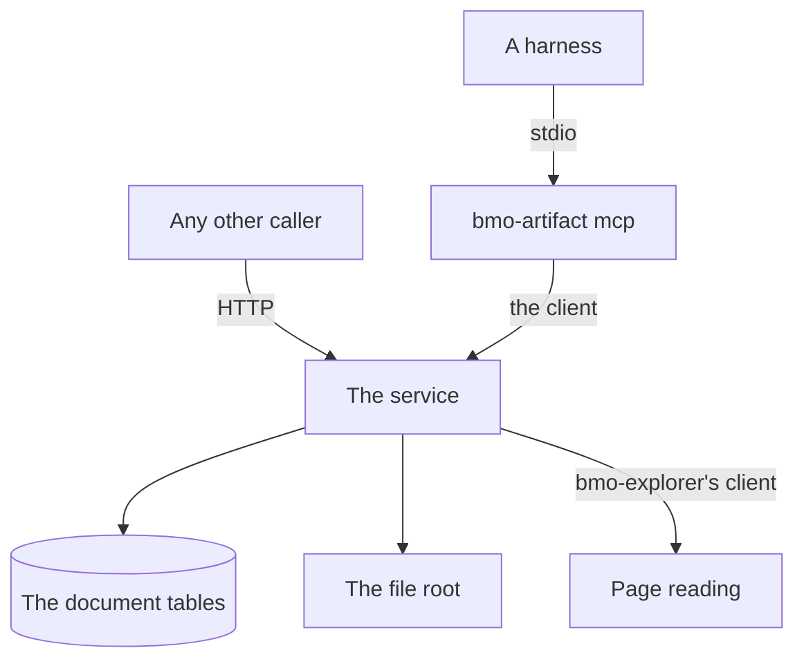

# The boundary: bmo-artifact

bmo-artifact keeps documents, finds them again and shares them by link: records, learning books, imported
pages and HTML pages, each with its body, its attachments, the pages it refers to and its cover picture. It
is an upstream (bmo-chat's `docs/conventions.md`, 「Upstream and downstream」): a harness takes it as its
first entry point through its MCP server, with no console and no other unit running beside it but the page
reader it imports through. It runs no research and speaks no narration: a research run is a client's work
that files its result here, and a narration is a sound a client attaches. This document is the whole of what
it serves and of what it calls; another repository reaches it through nothing else.

## Versioning

- **The repository has one version,** in `VERSION`, the Cargo manifest and the console bundle's package,
  which `GET /health`, the OpenAPI document and the MCP server's `serverInfo` all answer.
- **It is numbered as bmo-chat's `docs/conventions.md` says (「Versions」):** before the first release
  `0.1.0`, then `0.1.0-rev.<n>`, one revision a version bump, whatever the change.

## The wire

- **The wire format is bmo-chat's** (`docs/conventions.md`, 「The common wire format」 and 「API design」):
  camelCase keys, times in epoch milliseconds, ids as signed 64-bit integers, a page as `items` and
  `more`, a failure as a status with `code` and `error`.
- **Every route takes a bearer token,** as `Authorization: Bearer <token>`: the service's token or the
  console's, both named by the settings. A missing or wrong token is refused 401 `unauthorized`; an empty
  token in the settings lets no caller in by it.
- **The service's token reaches every route.** The console's token reaches only what its screens use, under
  the guard 「The console」 states.
- **The paths carry no prefix.** Whatever serves the service to a browser mounts it under its own path.
- **A caller's strings are opaque:** `scope` is what a document or an import is held under, `actorName`
  who filed it, and `labels` the caller's own metadata, an object of strings. The service stores and
  matches them and never reads meaning into them.
- **Every answer is English,** a sentence or a status code.
- **`docs/openapi.json` is the contract,** an OpenAPI 3.1 document generated from the service's own types:
  every route with its parameters, bodies, answers and codes and how far the console's token reaches it under
  `x-console`, the events under `x-events`, the tools under `x-tools`, the plugin under `x-harness` and the
  units it calls under `x-calls`. A test fails where the
  committed document differs from what the code generates; `bmo-artifact openapi` prints it.

### Codes

| Status | `code` | When |
|---|---|---|
| 400 | `bad-request` | the body, the query or a path key is not the shape the route takes; the sentence names what |
| 401 | `unauthorized` | the token is missing or wrong |
| 403 | `forbidden` | the console's token on a route its screens do not use, or without the role or owner key the screen needs |
| 404 | `no-route` | no route answers this method and path |
| 404 | `not-found` | nothing stands at the key the path names |
| 409 | `conflict` | the member does not take the change: a body for a page, HTML for any other kind |
| 410 | `gone` | a share link that has ended, and what it opened; an event stream resumed from before the window the service keeps |
| 413 | `too-large` | the body or an attachment is over its ceiling |
| 500 | `failed` | the service failed: its store or its file root; the sentence is the failure |

### Lists

- **A page is newest first** unless its route says otherwise, at most `limit` items, 30 where none is
  given and 200 at most; a `limit` that is not a whole number from 1 is refused `bad-request`.
- **`before` and `after` are ids:** `before` asks for the members older than the one named, `after` for the
  ones newer. A page answers `more` where something stands past its last item.

## Documents

A document is one row of the document tables and one file under the file root (docs/artifact.md, 「Where it
lives」).

| Field | Holds |
|---|---|
| `id` | the document's number |
| `kind` | one of the kinds below |
| `title` | its title |
| `scope` | what it is held under, null where none was given |
| `actorName` | who filed it |
| `labels` | the caller's metadata |
| `description` | what it reads as before it is opened: the one the filer gave, else a page's declared description, else the opening prose of its body as plain words; cut at 160 characters; null where it has none |
| `attachmentCount` | how many files it keeps |
| `hasPicture` | whether it keeps a picture, so `GET /documents/{documentId}/picture` has a cover to send |
| `createdAt`, `changedAt` | when it was filed and last rewritten |

### Kinds

Each kind is a module of its own answering one shape (docs/artifact.md, 「Kinds」); `GET /document-kinds`
lists them in the catalogue's order, each `name`, `description`, `hosted` (whether the document is opened
as the page it keeps) and `contentsDepth` (how many levels of its headings its table of contents lists,
0 for none); its `after` is a kind's place in the catalogue, counted from 1. A row whose kind no module
answers reads as `record`.

| Kind | What it is | Its file |
|---|---|---|
| `record` | data put in order and kept | the markdown body as filed |
| `learning` | study material, a book of parts, chapters and sections | the markdown body as filed |
| `import` | a page brought in whole through `POST /imports` | the markdown the import wrote |
| `page` | an HTML page kept as it stands | the HTML as filed |

### Labels

`GET /label-values` answers the distinct values the label `key` holds across the listed documents, each
`value` and `count` (how many documents carry it), the most carried first and, among equals, in the
values' order. A page answers at most `limit`, `more` where values stand past it, and takes no cursor. A
blank `key` is refused `bad-request`. The values are the callers' own strings, matched as they are written.

### Routes

| Route | Takes | Answers |
|---|---|---|
| `GET /documents` | query `kind?`, `scope?`, `label?`, `q?`, `before?`, `after?`, `limit?` | 200, a page of documents |
| `POST /documents` | `kind`, `title`, `body?`, `html?`, `scope?`, `actorName`, `labels`, `description?` | 201, the document |
| `GET /documents/{documentId}` | | 200, the document |
| `PATCH /documents/{documentId}` | `title?`, `body?`, `html?`, `labels` | 200, the document |
| `DELETE /documents/{documentId}` | | 204 |
| `GET /documents/{documentId}/content` | query `scheme?`, `download?` | 200, the file |
| `GET /documents/{documentId}/picture` | | 200, the cover picture as JPEG |
| `GET /document-kinds` | query `after?`, `limit?` | 200, a page of kinds |
| `GET /label-values` | query `key`, `limit?` | 200, a page of the values one label holds |

- **`GET /documents` filters in the reading itself,** so a filtered page is a full one. `kind` holds it to
  one kind and `scope` to one scope; `label` is `key:value` for documents whose label `key` is `value`, or
  `key` alone for those carrying it; `q`, cut to 200 characters, holds it to documents saying the phrase,
  matched whole and without regard to case in the title, the labels and the body, and, where the phrase is a
  number with or without a leading `#`, to the document of that number as well. A blank `q` is no search.
- **`POST /documents` files a document.** `page` takes `html` and nothing in `body`; every other kind takes
  `body` and no `html`. The title is required, except for a page whose own `title` element gives one.
  Each distinct http or https link the body makes becomes one of the document's references. Refused
  `bad-request` for a kind no module answers, an empty title or body, or a body and HTML given the wrong
  way round.
- **A number that stands for no document answers 404 `not-found`** on `GET /documents/{documentId}` and
  every route under it: none was filed under it, or its row left no document (docs/artifact.md, 「Where it
  lives」).
- **`PATCH /documents/{documentId}` rewrites it under its number;** its attachments and share links stay.
  `labels` replaces the labels whole; a `title`, `body` or `html` given replaces that one, and its
  references are read again from a new body. A body for a page or HTML for any other kind is refused
  409 `conflict`.
- **`DELETE /documents/{documentId}` lets go of the document** as letting go of its scope lets go of each it
  holds (「Scopes」): its row, its labels, its files, attachments and references, and its share link, which
  leaves its note behind. A reading issued for it opens nothing after. An import that filed it keeps its own
  record. It is a `document.deleted`, and its link a `share.deleted`.
- **`GET /documents/{documentId}/content`** sends the file: `text/markdown` for a markdown kind, never
  cached. A page goes out as a hosted page (docs/artifact.md, 「An HTML page」): its prelude ahead of its
  first element in the scheme `scheme` names, `light`, `dark` or `system`, the design's default where none is named, under the
  sandboxed page policy. Its sounds stand in the player speaking the language `language` names, a locale of the
  console bundle's words, English where it names none or one the words do not hold, and play from a reading
  address (「Readings」). `download=true` sends the file itself to keep, under its name. 404 `not-found`
  where the document has no file inside its folder.
- **`GET /documents/{documentId}/picture`** sends the picture a link's preview card shows: the first its
  body draws by a kept file's name (docs/artifact.md, 「Attachments」), else the first it keeps, upright,
  fitted inside 1200 pixels, never enlarged, laid on white, as JPEG. 404 `not-found` where it has none.

## Attachments

| Field | Holds |
|---|---|
| `id`, `documentId` | the attachment and its document |
| `name` | the name it is shown and named by in the body; a last part such as `-ko` before the extension is the language it is in (docs/artifact.md, 「Attachments」) |
| `mediaType` | its type as kept |
| `kind` | what it is read as: `image`, `audio`, `video`, `text`, `page` or `file` |
| `byteCount` | its size |
| `role` | the caller's word for its part in the document, null for none; `head` marks a file a reader is shown at a markdown document's head, a narration's sound among them, which the reader plays in the listen band; a sound named as a head sound is with another language stands beside it there (docs/artifact.md, 「How a document is drawn」). A page stands its sounds where it writes them, by their names (docs/artifact.md, 「An HTML page」) |
| `createdAt` | when it was kept |

| Route | Takes | Answers |
|---|---|---|
| `GET /documents/{documentId}/attachments` | query `after?`, `limit?` | 200, a page of attachments, in the order they were kept |
| `POST /documents/{documentId}/attachments` | `name`, `mediaType`, `role?`, `content` in base64 | 201, the attachment |
| `GET /documents/{documentId}/attachments/{attachmentId}` | query `scheme?`, `language?`, `download?`; the `Range` header | 200 or 206, the bytes |

- **A file is kept as docs/artifact.md 「Attachments」 says:** its kind read from its bytes and its name, a
  picture kept upright as AVIF, a name the document already keeps refused `bad-request`. One file is at
  most 64 MiB, refused `too-large` past it.
- **The bytes are served** with `Range` answered 206, an HTML file as a hosted page as the content route
  does, and every other file under the policy that lets nothing on it run. `download=true` sends it to
  keep. An attachment of another document is `not-found`.

## References

A reference is a page a document refers to: a link its body makes, the page an import came from, or a
work that page cites.

| Field | Holds |
|---|---|
| `id`, `documentId` | the reference and its document |
| `url` | the page's address |
| `title` | the page's title as the document or its preview gives it, null where neither does |
| `preview` | the description the page declares for a preview, null where it declares none or has not been read |

| Route | Takes | Answers |
|---|---|---|
| `GET /documents/{documentId}/references` | query `after?`, `limit?` | 200, a page of references, in the document's order |
| `GET /documents/{documentId}/references/{referenceId}` | | 200, the reference, its preview read |
| `GET /documents/{documentId}/references/{referenceId}/image` | | 200, the page's preview picture |

- **A preview is read through bmo-explorer's client** (「What this service calls」) and kept under the file
  root: a preview for a week, a picture for a month, a failure for a day. The list answers what is kept; one
  reference read alone reads its preview where none is kept fresh, and waits for bmo-explorer's answer however
  long it takes.
- **The image** goes out as the type its bytes are, not sniffed and sandboxed; 404 `not-found` where the
  page declares none or it could not be fetched.

## Share links

A share link opens one document for whoever holds its token. A document has at most one live link.

| Field | Holds |
|---|---|
| `token` | the link's token, 8 to 128 letters, digits, `-` and `_` |
| `documentId` | the document it opens |
| `url` | the share address the settings name, a `/` and the token |
| `createdAt` | when it was made |
| `expiresAt` | when it stops opening, null for a link with no end |

| Route | Takes | Answers |
|---|---|---|
| `GET /shares` | query `documentId?`, `after?`, `limit?` | 200, a page of live links, oldest first; `after` is a `createdAt` |
| `POST /shares` | `documentId`, `expiresAt?` | 201, the link made; 200, the live link that already stands |
| `GET /shares/{token}` | | 200, the link |
| `DELETE /shares/{token}` | | 204 |

The **share reads** open, to whoever holds a live link's token, the one document it opens, each answering
what the route under `/documents/{documentId}` it stands for answers for that document:

| Route | Takes | Answers |
|---|---|---|
| `GET /shares/{token}/document` | | 200, the document |
| `GET /shares/{token}/kind` | | 200, the document's kind, as `GET /document-kinds` lists it |
| `GET /shares/{token}/content` | query `scheme?`, `language?`, `download?` | 200, the file |
| `GET /shares/{token}/picture` | | 200, the cover picture as JPEG |
| `GET /shares/{token}/attachments` | query `after?`, `limit?` | 200, a page of attachments |
| `GET /shares/{token}/attachments/{attachmentId}` | query `scheme?`, `language?`, `download?`; the `Range` header | 200 or 206, the bytes, answering any origin |
| `GET /shares/{token}/references` | query `after?`, `limit?` | 200, a page of references |
| `GET /shares/{token}/references/{referenceId}` | | 200, the reference, its preview read |
| `GET /shares/{token}/references/{referenceId}/image` | | 200, the page's preview picture |

- **A page a share read sends** has its sounds play from the share route of their attachments
  (docs/artifact.md, 「An HTML page」).
- **Every read and every making sweeps away the links whose time has passed,** each a `share.deleted`.
- **`POST /shares`** refuses an `expiresAt` not in the future `bad-request`, and a document that does not
  stand `not-found`.
- **A share read answers for a live token alone,** and only with what that link's document holds: an
  attachment or a reference of another document is `not-found`. `GET /shares/{token}` and the share reads
  are the whole of what the link opens.
- **A link that has ended leaves a note of what it opened** (docs/artifact.md, 「Share links」): its token and
  that token alone answers 410 `gone`, with the sentence naming the document's title and its number, where the
  link ended by its time, by `DELETE /shares/{token}` or by its document being let go of. `GET
  /shares/{token}` and every share read of that token answer so, and no live link stands there any more.
- **A token that never named a link is `not-found`,** with the plain sentence saying so.
- **A reader with no token of the service's** opens a link through whoever serves the service to a
  browser: it reads the link, then the document and everything of it through the share reads, each carrying
  the token.

The **share head** answers what a live link reads as before it is opened, the preview a chat app or a browser
draws its card from, as data a console writes into the head of the page it serves at the link's address
(bmo-ui's `docs/console-bundles.md`, 「Share pages」; docs/artifact.md, 「Where a person reads it」):

| Route | Takes | Answers |
|---|---|---|
| `GET /shares/{token}/head` | query `language?` | 200, the head |

| Field | Holds |
|---|---|
| `title` | the document's title, as the page shows it |
| `description` | the document's description led by its kind's word where the page names the kind over the title, joined in the pack's sentence; absent where the document has none |
| `image` | `/shares/{token}/picture` with the link's token, the share read of the cover picture; absent where the document keeps none |
| `url` | the link's address, as `GET /shares/{token}` answers it |
| `locale` | the pack's `artifact.preview.locale` |
| `siteName` | the pack's `artifact.preview.site_name` |
| `type` | `article` |
| `kind` | the pack's word for the document's kind, as written where the pack has none; absent for a kind the page draws whole with no title over it |

- **The words are the console bundle's pack** in the language `language` names, a locale of the bundle's words,
  and in English where none is named or the words hold none of it.
- **It is held to the token** as a share read is: a token that never named a link is `not-found`, one whose
  link has ended `gone`, and where no bundle was built it is `not-found`.

### Readings

A reading token opens one document's attachments to the page the console's own reader opens, for twelve
hours, and the player's script goes out on its own (docs/artifact.md, 「Readings」). Both are share reads: a
console relays them with no session, as a sandboxed page asks for them with none.

| Route | Takes | Answers |
|---|---|---|
| `GET /readings/{token}/attachments/{attachmentId}` | query `scheme?`, `language?`, `download?`; the `Range` header | 200 or 206, the bytes, answering any origin |
| `GET /player/{token}` | | 200, the player's script, the token being its file's name |

- **A reading token whose signature does not hold, or whose time has passed,** is `not-found`, and so is an
  attachment of another document.
- **The player's file name** is `bmo-audio-player`, the first sixteen hexadecimal digits of the SHA-256 of
  its bytes and `.js`; it goes out as `text/javascript`, kept a year. Any other name, or a bundle built with no
  player, is `not-found`.

## Publications

A publication files a document and opens a link with no end to it in one call: what a document is handed to
somebody as, the address they keep rather than a copy they were sent.

| Field | Holds |
|---|---|
| `document` | the document filed, as `POST /documents` answers it |
| `share` | the link that opens it, its `expiresAt` null |

| Route | Takes | Answers |
|---|---|---|
| `POST /publications` | `kind`, `title`, `body?`, `html?`, `scope?`, `actorName`, `labels`, `description?` | 201, the document and its link |

- **The document is filed as `POST /documents` files one,** taking the same body and refusing the same ways.
- **The link has no end** and names the document rather than a body: a rewrite of that document keeps the
  link, and the link serves the newest body whenever it is opened (docs/artifact.md, 「Share links」).
- **The link is a share link like any other** once made: `GET /shares`, the share reads and `DELETE
  /shares/{token}` answer it, and its token answers what stood once it has ended.
- **Only the service's token publishes.** The console's does not reach the route, since no screen files a
  document.
- **Each half is told:** a `document.created` for the document and a `share.created` for the link.

## Imports

An import brings a page in whole as a document of kind `import` (docs/artifact.md, 「A page imported
whole」).

| Field | Holds |
|---|---|
| `id` | the import's number |
| `url` | the address asked for |
| `state` | `fetching`, `filed` or `failed` |
| `documentId` | the document it filed, null until it is `filed` |
| `error` | why it failed, null otherwise |
| `createdAt` | when it was asked for |

| Route | Takes | Answers |
|---|---|---|
| `POST /imports` | `url`, `title?`, `scope?`, `actorName` | 201, the import, `fetching` |
| `GET /imports/{importId}` | | 200, the import |

- **The page is read after the answer,** and the import moves to `filed` or `failed` once it is, each an
  `import.changed`. The document it files carries the import's `scope` and `actorName`, and the `title`
  given, else the page's own.
- **`POST /imports`** refuses an address that is not http or https `bad-request`. A page that cannot be read
  is no refusal of the route: the import is `failed`, its error the page reader's sentence.
- **An import still `fetching` when the service stops** is `failed` when it starts again, its error saying
  the service stopped before the page was read.

## Scopes

| Route | Takes | Answers |
|---|---|---|
| `GET /scopes/{scope}` | | 200, what the service holds under the scope |
| `DELETE /scopes/{scope}` | query `dryRun?` | 200, what was let go of, or with `dryRun=true` what would be |

- **The answer** is `scope`, `counts` (`documents`, `attachments`, `shares` and `imports` held under it)
  and `state`: null for a read, `released` once let go of, `preview` for a dry run. A scope holding
  nothing is `not-found`.
- **Letting go** removes every document held under the scope with its files, attachments, references and
  share links, each as `DELETE /documents/{documentId}` lets go of one, and every import asked under it.
  Each document removed is a `document.deleted` and each link a `share.deleted`.

## Events

| Kind | When | `data` |
|---|---|---|
| `document.created` | a document filed, by a caller or an import | the document |
| `document.changed` | a document rewritten | the document |
| `document.deleted` | a document let go of, alone or with its scope | `id` |
| `attachment.created` | a file attached | the attachment |
| `share.created` | a link made | the link |
| `share.deleted` | a link taken away, swept or let go of | `token` |
| `import.created` | an import asked for | the import |
| `import.changed` | an import filed or failed | the import |

- **`GET /events`** is the stream, as server-sent events, each `event` its kind, `id` its number and `data`
  `{"id", "kind", "at", "data"}`; asked with `Accept: application/json` it answers a page of the same
  events, oldest first.
- **It narrows** by `kinds`, a comma-separated list, and by `scope`, to the events of members held under
  it; it resumes after `Last-Event-ID` or `after`, and pages by `limit`, 100 where none is given and 1000
  at most.
- **The service keeps a week of events.** A resume from before the window is refused 410 `gone`, and the
  reader reads the collections again.
- **A comment line every fifteen seconds** keeps the stream open, and an event reaches a reader within a
  second of being kept.
- **The stream ends when the service is stopped,** and the reader resumes after its last event once the
  service answers again.

## Health

- **`GET /health`** answers 200 with `ready`, `reason` (null when ready) and `version`. It is not ready
  while the database does not answer, and the reason says so.

## The command

`bmo-artifact` is one binary: the service, its command and its harness plugin alike.

- **`bmo-artifact serve`** settles the document tables and answers the routes.
- **`bmo-artifact migrate`** brings the database the settings name up to the schema and prints how many
  migrations it ran; the deployment and the testbed's template run it.
- **`bmo-artifact health`** asks the service the settings name, waits for the answer however long it takes,
  and ends 0 where it answers ready; a refused or broken connection ends it 1.
- **`bmo-artifact openapi`** prints the OpenAPI document the code generates.
- **`bmo-artifact mcp [--address <url>]`** serves the harness tools (「The harness plugin」).
- **`bmo-artifact html-read <file> [--pictures <dir>] [--stem <name>] [--from <line>]`** reads an HTML file
  for its words in order, cut at the answer ceiling (docs/artifact.md, 「An HTML page」).
- **`bmo-artifact archive doc`** files or rewrites a document from a shell (「The archive verb」).
- **`bmo-artifact nouns`** prints the nouns `bmo` dispatches to this command, one a line: `archive doc` and
  `html-read`. It reads no settings, so it answers wherever the caller stands; no noun carries a mark.
- **The nouns' words:** `html-read` is `bmo-artifact html-read <file> [--pictures <dir>] [--stem <name>]
  [--from <line>]`. It calls no route: it reads the file where it stands. `archive doc` is below.
- **The settings a command stands on** are the ones in the directory it was started in, where `settings.toml`
  stands there; from any other directory, the deployed release's own, above the binary's `bin/`. A path a
  setting names that is relative is read from the directory those settings stand in, wherever the process
  was started.
- **How a command ends:** 0 on success; a refusal on standard error and 1 otherwise.

## The archive verb

`bmo archive doc --title <words> (--body <file> | --html <file>) [--replace <id>] [--chat <room>] [--by <name>]`
files a document from a shell and prints its number and the permanent link to hand to a reader, a line each.

| Option | What it does |
|---|---|
| `--title <words>` | Its title; required |
| `--body <file>` | Its words, as markdown: a `record` |
| `--html <file>` | An HTML page as it stands: a `page`; exactly one of `--body` and `--html` is named |
| `--replace <id>` | Rewrites that document under its number, which keeps its link and its attachments, in place of filing a new one |
| `--chat <room>` | The room it is held under as its `scope`; it is the owner's own where left out |
| `--by <name>` | Who files it: `BMO_TURN_AGENT` where left out, then `USER` |

- **A new document goes through `POST /publications`,** a rewrite through `PATCH /documents/{documentId}` and
  `POST /shares`, which answers the live link that stands.
- **It speaks no narration.** A narration is a sound a client attaches (`POST /documents/{documentId}/attachments`).

## The client

`bmo_artifact::client` is the service's own Rust client: one method for each route, sending and reading
the types of `bmo_artifact::wire`, which the routes answer with and the OpenAPI document is generated from.
A refusal comes back as the route's status with its `code` and `error`. A call waits for its answer however
long the service takes, and ends only with the answer or a refused or broken connection. The command and the
MCP server reach the service through it. The console bundle reads the TypeScript types generated from `docs/openapi.json`.

## The harness plugin

The plugin is `bmo-artifact`: the MCP server `bmo-artifact mcp` starts and the skill
`skills/bmo-artifact/SKILL.md`, which tells a harness when and how to use it. The server reaches the
service at `--address`, or at the settings' `server.listen` where none is given, with the settings' token.
Each tool is one call of the client, answered as structured content; a refusal is a tool result marked
`isError` whose text is the route's status, `code` and `error`. A harness publishes what it wrote with
`artifact_publish`, which hands it back the document's number and the link to hand to a reader; finds earlier
documents with `artifact_search`; and opens a link on a document already filed with `artifact_share`.

| Tool | Calls | Input | Output |
|---|---|---|---|
| `artifact_documents` | `GET /documents` | the route's query | a page of documents |
| `artifact_file` | `POST /documents` | `body`, the document's input | the document |
| `artifact_publish` | `POST /publications` | `title`, `description?`, `body` or `path`, `kind?`, `scope?`, `actorName` | the document and its permanent link |
| `artifact_document` | `GET /documents/{documentId}` | `documentId` | the document |
| `artifact_rewrite` | `PATCH /documents/{documentId}` | `documentId` and the route's body | the document |
| `artifact_content` | `GET /documents/{documentId}/content` | `documentId` | `content`, the file in base64, and `mediaType` |
| `artifact_attach` | `POST /documents/{documentId}/attachments` | `documentId` and the route's body | the attachment |
| `artifact_shares` | `GET /shares` | the route's query | a page of links |
| `artifact_share` | `POST /shares` | the route's body | the link |
| `artifact_unshare` | `DELETE /shares/{token}` | `token` | an empty object |
| `artifact_import` | `POST /imports` | the route's body | the import |
| `artifact_search` | `GET /documents` | `q`, `kind?`, `scope?` | a page of documents |

- **`artifact_publish`'s words come as `body`, or as the `path` of a file on the machine the harness runs
  on,** read whole and refused over the size one call may carry. Its link is absolute to the share address the
  settings name, so the harness hands the reader what the service answered and adds nothing to it.

## The console

The document screens are a console bundle by bmo-ui's console plugin contract (bmo-ui's
`docs/console-bundles.md`), built from `client/` (docs/layout.md, 「The console bundle」). The service answers
the bundle's manifest, its module, its stylesheet and its words, and guards every route its screens use.

| Route | Takes | Answers |
|---|---|---|
| `GET /console-manifest` | | 200, the manifest |
| `GET /console/words` | | 200, the bundle's words |
| `GET /console/{file}` | | 200, the module or the stylesheet the manifest names |

- **The manifest** is the contract's shape: the bundle `artifact`, its menu title the key
  `artifact.title.screen`, its icon, its screens under `/artifact`, the path `/archive` as the one former screen
  path they stood under, the service `artifact`, the paths of its
  module, its stylesheet and its words, and the role `member`. Every call the screens make stands under the
  API prefix `/`; no screen needs the owner key, reads the event stream or opens a socket, and no event is
  raised as a notice. Under `shareReads` it names `GET /shares/{token}`, every share read (「Share links」),
  the reads the share page makes, and the reading's attachment read and the player's script (「Readings」),
  which a hosted page makes. Under `shareHead` it names `GET /shares/{token}/head` (「Share links」), which a
  console asks for a share page's head.
- **The module and the stylesheet** are the files the build of `client/` writes into the folder the settings
  name, read when the service starts, beside bmo-ui's audio player script, which the build copies there and
  the service answers on its own route (「Readings」). Each is answered at `/console/` and a name carrying the
  first sixteen hexadecimal digits of the SHA-256 of its bytes, so its path changes whenever its bytes do,
  and may be kept by whoever loaded it. A file name the manifest does not name is `not-found`.
- **The words** are each locale's words of the bundle's pack under the locale's code, every key under
  `artifact`, as the build writes them beside the module.
- **Where the folder holds no module,** the manifest, the module, the stylesheet and the words are all
  `not-found`, so a console leaves the service out.
- **The guard.** A call with the console's token is the console relaying for a reader, and it reaches:
  - the manifest, the words, the module, the stylesheet, `GET /shares/{token}`, the share head and the share reads with no
    role and no owner key, since a reader with no sign-in opens a share page by them; a share read is held to
    its token;
  - every other route the screens use where its `Owner-Role` header is a role that
    allows `member`, either role; one with that header missing or naming no role is refused 403
    `forbidden`;
  - no other route: each is refused 403 `forbidden`.
- **The routes the screens use** are the reads of documents, their content, pictures, attachments,
  references, kinds and label values, and the reading, making and ending of share links.

## What this service calls

| Unit | Through | For |
|---|---|---|
| bmo-explorer | its published client crate, `bmo_explorer::client`, at 0.1.0-rev.5 | an import's page and figures; a reference's preview and picture |

- **The client is opened over the data root the settings name,** where bmo-explorer keeps its own folder
  (bmo-explorer's `docs/api.md`, 「The client」). It checks every address before it connects and paces each
  host.
- **An import** reads the page's markup with `fetch_page` and each of its pictures with `fetch_raster`.
- **A reference's preview** is `link_preview`, and its picture `fetch_raster`.

## Settings

The settings are read at start in layers, each overriding the one before: the repository's
`settings.toml`, then `settings.local.toml` beside it, then `BMO_ARTIFACT_<TABLE>__<KEY>` in the
environment. A path a key names that is relative is read from the directory those settings stand in,
wherever the process was started.

| Table | Key | What it is |
|---|---|---|
| `server` | `listen` | where the service answers, as `host:port` |
| `server` | `token` | the service's token, which reaches every route |
| `console` | `token` | the console's token, which reaches what the screens use (「The console」) |
| `console` | `bundle` | the folder the build of `client/` writes the module, its stylesheet and its words into; `client/dist` where none is named |
| `database` | `url` | the PostgreSQL database the document tables stand in |
| `files` | `root` | the folder each document's folder stands under |
| `explorer` | `data_root` | the data root bmo-explorer's client is opened over |
| `share` | `address` | the address a link's `url` stands under |
| `wording` | `file` | the document wording file; the English default in `lang/` where none is named |

## The document wording

- **The lines the service writes into a document a person reads,** an import's line for a figure that
  could not be captured among them, come from the wording file, each filled in by its `{name}` marks. A
  file holds every key the English default holds and no other; the service does not start on one that
  cannot be read, lacks a key or holds one more, and the refusal names the file and the key.

## Missing in siblings

What another repository must gain or settle for this one to stand on it, each for that repository's own
worker:

- **The console that serves this bundle:** it calls this service with the console's token, finds the bundle
  by its manifest and loads its module (bmo-ui's `docs/console-bundles.md`). A share link is opened by a
  reader who is not signed in, so the console serves the bundle's `/artifact/share/<token>` screen and relays
  the share reads the manifest names without its sign-in and with no role (bmo-ui's `docs/console-bundles.md`,
  「Share pages」), answers every address under the former screen path `/archive` as moved to the same address
  under `/artifact` (「A screen that moved」), and sets this service's share address to that screen's; this
  service answers only callers holding one of its tokens.
- **The callers of the routes this service no longer serves:** research runs and their settings,
  narrations, the holding read by a chat id and the filing verbs are gone. A research run or a narration
  is a client's own work that files through this service's MCP server, and what a caller files is held
  under the scope it writes.
