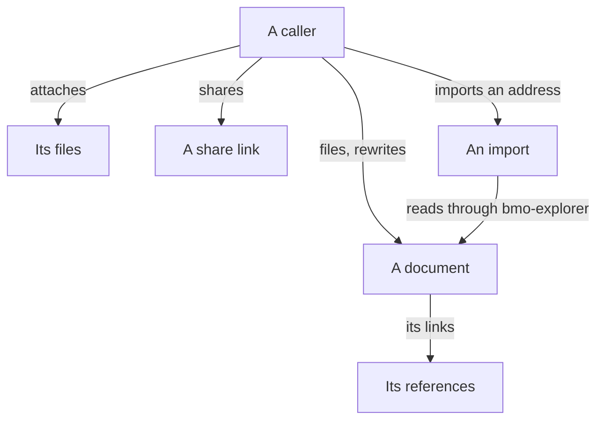

# The documents

This is the canonical design statement of bmo-artifact. The code is one realisation of it. `docs/api.md`
is the boundary this design is reached through, and `docs/layout.md` is where its parts sit in the
repository.

## What the service keeps

- **Documents a caller files for a person to read later.** A record, study material, a web page brought
  in whole, or an HTML page kept as it stands.
- **The files beside each document.** Pictures, sound, video, text files and any other file, shown or
  played where the document is read.
- **The pages each document refers to,** with what each page says of itself for a preview.
- **Share links,** each opening one document for whoever holds it.
- **Nothing it did not keep.** It runs no research and speaks no narration: a research run is a client's
  own work that files its result here, and a narration is a sound a client attaches with the role `head`.
  It knows no caller: a document's `scope`, `actorName` and `labels` are the caller's own strings.

## Kinds

Every document has a kind, and the kind decides how it is filed and read.

- **Each kind is its own module.** Each answers one shape: its name, a sentence saying what it is, whether
  it is the HTML page it keeps, and how many levels of its headings a table of contents lists.
  - One catalogue lists the modules, in the order `GET /document-kinds` answers them.
  - The routes and the console bundle ask a document's kind, and never branch on a kind's name.
  - Adding a kind is adding its module and its line in the catalogue.
- **`record`**: data put in order and kept, as a markdown body. Its contents are its headings, to two
  levels.
- **`learning`**: study material laid out as a book, as a markdown body. Its contents are three levels: a
  top heading is a part, the one under it a chapter, the one under that a section.
- **`import`**: a web page brought in whole (「A page imported whole」). Its contents are the page's own
  headings, to three levels.
- **`page`**: an HTML page kept as it stands (「An HTML page」). It is filed as its HTML and opened as that
  page wherever it is opened, so it has no contents.
- **A row whose kind no module answers reads as `record`,** so a document filed before the catalogue knew
  its kind is still answered and listed among the records.

## Where it lives

A document is rows of this service's PostgreSQL database and files under the file root. The database's
address and the file root are settings; no other unit reads or writes either.

- **The rows are the identity:** the list, the filters and the search are read from them.
- **The file is what a person reads:** the markdown as filed, or the HTML.
- **A row that left no document is no document.** A row that names no file, or is marked as having
  written none, as a research run that failed, died or found nothing, is never listed and is read as
  absent on every route; its number is not given again.

### The tables

| Table | One row per | What it holds |
|---|---|---|
| `searches` | document | its kind, title, scope, actor, labels, description, its file's path, and its times |
| `search_findings` | piece of a document's body | the body's words the search reads; a document filed here keeps its body as one piece |
| `search_sources` | reference | the page's address and title, and the piece of the body that refers to it |
| `archive_attachments` | kept file | what it is read as, its type, size, name, role, path and when it was kept |
| `search_images` | picture kept before the attachments held pictures | read once into the attachments, never written |
| `web_search_shares` | share link | its token, its document, when it was made and when it ends |
| `imports` | import | the address asked, the title, scope and actor asked, its state, its document or why it failed |
| `events` | event | its kind, when it was kept, the scope of its member and the member |

- **The tables keep their names and their old columns,** since the documents a deployment brings in from
  an earlier archive keep their numbers, paths and share links on them. A migration a database may already
  have run is never rewritten or removed; a change of shape is a new migration.
- **A document's times:** `started_at` and `finished_at` are epoch seconds, as the earlier rows keep them;
  `changed_at` is epoch milliseconds. A document is answered in milliseconds.
- **A document filed here fills the earlier required columns** with its own values: the title as its
  question, its kind as its depth, the state `done`, and its moment of filing as both its start and its
  end.
- **A row filed before the scope was kept** carries its old grouping number as its scope, in decimal, and
  its writer as its actor.
- **Settling.** Once in each process, before the first statement on the document tables, a row that names
  no kind is given one (`import` where its question opens with the prefix the settings name, its old kind
  otherwise) and a writer, and the pictures of `search_images` not yet among the attachments are copied
  there. `migrate` does not settle, since it may run before the tables exist.
- **A share link's times are epoch seconds** in its row, and milliseconds on the wire.

### The file root

- **A document's folder** is `searches/<document id>/` under the file root.
  - A markdown document's file is `document.md` in it; a page's is `page.html`. The row names the file by
    its whole path, so a document's file never moves.
  - Every attachment is kept under `attachments/` in it, named by a digest of its name and its own name.
- **Previews** of the pages documents refer to are kept under `web-cache/`.
- **Every file is served only from inside the file root,** every link resolved.

## Filing a document

- **The kind decides what is filed.** A `page` takes HTML and no body; every other kind takes a markdown
  body and no HTML.
- **Nothing is written for a refusal.** The kind, the title, the body or HTML and the actor are checked
  before the row exists, and the row, its body, its references and its file are written together.
- **The title** is the one given; a page whose title is left empty takes its own `title` element, and a
  page with neither is refused.
- **The description** is what the document reads as before it is opened:
  - for a markdown document, the opening prose of its body as plain words, headings, pictures, code and
    tables left out, cut at a space near 160 characters and marked as cut;
  - for a page, its description meta, else the start of its words cut the same way.
- **The references** of a markdown document are each distinct http or https link its body makes, in the
  order it makes them, titled by the words the link is written as.
- **A rewrite** keeps the document's number, its attachments and its share links. Its labels are replaced
  whole; a title, body or HTML given replaces its own, and a new body's references replace the old ones.

## Attachments

- **What an attachment is:** a copy kept under the document's own folder, of what was handed over in the
  call.
- **What it is read as is read from its bytes and its name,** not taken on the caller's word.
  - The bytes decide first; the name decides between the forms one container holds, as an Ogg or a WebM
    is a sound or a video by what it was called.
  - A text is what decodes as UTF-8 with no NUL in it. A text whose name ends in `.html` or `.htm`, or
    whose first tag is a doctype or `html`, is a page.
  - Where the bytes say no more than a plain text or a bare file, the type the caller gave is kept.
- **A picture is kept as AVIF, upright,** inside 2048 pixels. A picture that will not convert, and a GIF
  or a WebP that may be animated, are kept as the bytes that came.
- **A body draws a kept picture by its name:** a markdown picture whose target is the name the file is
  kept under, or a path with no scheme whose last part is that name, is drawn from the kept file, and a
  link written either way opens it. A web address is never read as a kept name. A reader resolves the
  name under the route it reads the document on.
- **The role is the caller's word for the file's part.** `head` marks a file a reader is shown at the
  document's head; a narration's sound is attached with it.
- **Bounds:** one file is at most 64 MiB through the API, and a document keeps one file of each name.

## References

- **A reference is a page a document refers to,** kept as a row with its address and title.
- **A preview** is what the page declares for a link's card: its title, its description and its picture.
  It is read through bmo-explorer's client, which checks the address and paces each host, for a caller who
  is not to reach the outside server itself.
- **What is read is kept** under the file root: a preview for a week, a picture for a month, a failure for
  a day, and a read that ran out of time not at all. One read of an address runs at a time; a second
  asker waits for it and takes what it kept.
- **The list answers what is kept,** so listing never reaches the web; reading one reference reads its
  preview where none is kept fresh.

## Share links

- **A link is a row rather than a signature:** a link is read back long after it was made, and ended
  before its time, neither of which a signed capability can do.
- **The token is the link entire:** 32 random bytes in URL-safe base64, from which nothing is derived,
  naming the one row it was written for. A token not shaped as one issued here opens nothing.
- **A document has at most one live link.** Asking for a link where one stands answers the one that
  stands, so a link somebody is still handing out is never quietly replaced.
- **A link ends at the second its time falls in,** never before. Every read and every making sweeps away
  the links whose time has passed.
- **A link's address** is the share address the settings name, a `/` and the token. What answers that
  address is whoever serves the service to a browser: it reads the link, then the document, its content and
  its files by the document's number.

## A page imported whole

An import brings a web page in as a document of kind `import`, read as it stands: nothing is
researched, summarised or reordered.

- **The page is read after the caller is answered.** The import is `fetching` until it is `filed` with its
  document or `failed` with why; an import a stopped process left `fetching` is `failed` when the service
  starts again.
- **The page is read as served,** through bmo-explorer's client: its markup, at most 512 KiB of it, after
  every redirect. No script runs, so a page that draws itself with a script is read as its markup stands.
- **What is read:**
  - every link and picture address made absolute against the address the page was read at;
  - the title asked for, else the page's first `h1`, else its `title`, else its host;
  - its main content, the `article`, else `main`, else the body, written as markdown by a maintained
    converter, its navigation, footers, forms, scripts and styles left out.
- **Every figure where it stood:**
  - a picture is fetched through the client and kept as the document's file, named `figure-<n>` by its
    place among the page's figures;
  - an inline SVG drawing is kept as its own source, redrawn as a picture like any kept picture;
  - a figure that could not be kept stands as the wording file's line naming its number and its caption;
  - at most 40 figures are kept, and a picture written into the page as data, with no address to read,
    is left out.
- **Its references:** the page it was read from, titled by the document's title; the address asked for,
  where the page moved on from there; and each page of another host its body links to.

## An HTML page

The service hosts HTML pages the way a static host does. A page document is its HTML file: what goes out
is that file with the design and the reader's scheme put in front of it, and nothing is written in its
place.

- **Filing it:** the page is filed as its HTML, untouched. A page carries what it draws inside itself or
  over https, so it takes no body; files may still be attached beside it.
- **Reading it:** `bmo-artifact html-read <file>` gives a page's title and its words in order, a block to a
  line, headings as markdown headings and list items as dashes, scripts and styles not words.
  - Every picture written inside the page as a data address stands in the reading as a markdown picture
    named `picture-01` and onward; `--stem` names them otherwise, and `--pictures <dir>` writes them out.
  - The words are cut at the answer ceiling, and `--from` carries on at the line the cut names.
- **Its design is the service's where it brings none.** The design's page sheet and the reader's scheme
  go ahead of the page's own lines. What they do depends on what the page brings:
  - **No stylesheet of its own:** the page is drawn wholly in the design: the reading column, the
    masthead, the type, the tables, the boxes, and the palette of the reader's scheme.
  - **A style element marked `data-archive`:** an addition to the design, drawn in the design's colour
    variables, so it follows the scheme as well.
  - **Its own stylesheet, with no dark scheme declared:** the page keeps its layout and every part it
    names by a class or an id, and takes the design's type in the light palette over what it wrote for
    bare elements; where the reader's scheme is dark, it is drawn inverted with its hues turned back, and
    its pictures and films inverted again.
  - **A dark scheme of its own:** the page draws itself, and its own questions about the scheme are
    answered with the reader's scheme.
  - The sheet stands before anything the page draws, so the first paint is already in the scheme.
- **The parts a page builds with.** A page written on the design is plain HTML in a body the sheet lays
  out, drawing headings, paragraphs, lists, tables, quotations, code, figures and folds as a markdown
  document's, with these named parts beside them:
  - a `header` opening the body as the masthead, with an `eyebrow` line over its title and a paragraph
    under it saying what the page is;
  - a `lede` box for the key answer;
  - an `aside` for a note, toned `ok` or `warn`;
  - a `chip` for a short state, toned `ok`, `warn` or `bad`;
  - a `listen` band holding an audio player and a line on what it says;
  - a `grid` of boxes side by side, which fold to one column on a phone;
  - a table, which scrolls sideways inside itself where it is wider than the column;
  - a `footer`, which closes the page in the muted ink.
- **Hosting it.** The page goes out on its document's content route, and an HTML attachment on its own.
  - What goes out is the file as kept, with only a few lines ahead of it: one lets its copy buttons work
    in the sandbox, one hands a pressed picture to its frame (「Pictures open whole」), and one opens a
    link the page opens in its own window in a tab of its own. A download is the file itself.
  - **Sandbox:** it runs its own scripts, sandboxed, with an opaque origin of its own. It opens no
    connection, submits no form, loads what it is drawn with from inside itself or over https, and reaches
    nothing of the screen it was opened from.
  - **Framing:** it may be framed by the screen that opened it, and by no other site.
  - **One sandbox for both.** The sandbox, the rest of the policy and the lines that go ahead of the page
    are kept in the design's files; the server sends the page under them, and the console bundle's frame
    gives the page the same sandbox.
  - Every other attachment goes out under the policy that lets nothing on it run.

## How a document is drawn

One design draws every document, a markdown one and a page alike, in a light and a dark scheme. The
design is data files of this repository under `client/design/`, which the server reads to write a page's
sheet and the console bundle reads to draw a document.

- **The palette** is one set of document colours per scheme: a warm paper with a raised and a sunk
  surface, the ink in three strengths, a rule and a softer one, an accent, and a calm and a caution tone.
- **The reader's scheme** is light, dark, or whatever the reader's system asks. The request names it; a
  request that names none reads in the design's default, dark.
- **The masthead:** the kind's label over the title in the accent, the title large and bold across the
  reading width, breaking only between words unless a word has no break in it, and a rule in the ink
  closing it.
- **The body:** 16px words on a loose line; a section ruled off under its heading; a quotation a box on
  the sunk surface with an accent rule down its left; a table a rounded box on the raised surface with its
  head row on the sunk surface; code on the sunk surface; links in the accent.
- **A file with the role `head` stands at the head,** a sound in a player, before the body.
- **Diagrams** in a markdown body are fenced `mermaid` blocks, drawn in the design's colours; in a page,
  inline SVG in the page's own colours. A diagram names no colour of its own, so it is right in both
  schemes.

## Pictures open whole

A picture in a document opens in the picture viewer, for a markdown document and a page alike.

- **What opens it:** a plain press (the main button, no key held) on a picture the document draws. The
  viewer stands the picture whole over the screen, to zoom, move and pinch, and steps to the document's
  other pictures.
- **The run it walks** is every picture of the document that would open it, in the order they stand; a
  picture that is not drawn is not in it.
- **What stays with the document:** a picture inside a link, a button, a label or a fold's summary; one
  that answers a press of its own or stands in an element that does; a press the document's own script
  has handled; and a picture marked `data-archive-no-viewer` or standing in an element so marked.
- **A page asks from inside its frame.** The lines ahead of the page's own read its pictures by the same
  rule and hand the run to the frame as one message, which the frame takes only from that page and only
  for pictures over the web or written into the page as data. The page's file is never touched for this.
- **One rule for both,** kept in the design's file, which the console bundle and the page's lines both
  read.

## Where a person reads it

- **The console bundle in `client/`** draws the documents under the name Artifact (`docs/layout.md`, 「The
  console bundle」):
  - the list at `/archive`, narrowed by kind and by a phrase, each narrowing held in the address, each
    document beside its cover picture where it keeps one and alone where it keeps none;
  - one document at `/archive/<id>`: its masthead, its file drawn as markdown with a table of contents of
    its kind's depth, its files after it, its references beside it, each with the picture its preview
    declares; a page fills the screen in its frame;
  - one shared document at `/share/<token>`, alone: nothing of its state or the screens around it, and no
    other document.
- **A share page reads as its document before anything runs:** the document's title, its description and
  its cover picture stand as the page's preview head, the link is its canonical address, and it asks
  search engines not to index or follow it.

## Out of scope

- **Research and narration.** A research run and a spoken narration are a client's own work; each files
  what it makes here through the MCP server.
- **Talk and translations** of a document belong to whoever keeps the talk and the translations.
- **Visibility per caller.** Every caller holding the token reaches every document.
