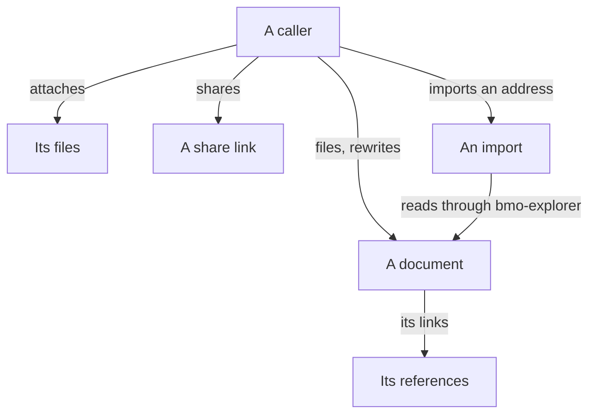

# The documents

This is the canonical design statement of bmo-artifact. The code is one realisation of it. `docs/api.md`
is the boundary this design is reached through, and `docs/layout.md` is where its parts sit in the
repository.

## What the service keeps

- **Documents a caller files for a person to read later.** A record, study material, a web page brought
  in whole, or an HTML page kept as it stands.
- **The files beside each document.** Pictures, sound, video, text files and any other file, shown or
  played where the document is read.
- **The pages each document refers to,** with what each page says of itself for a preview.
- **Share links,** each opening one document for whoever holds it.
- **Nothing it did not keep.** It runs no research and speaks no narration: a research run is a client's
  own work that files its result here, and a narration is a sound a client attaches with the role `head`.
  It knows no caller: a document's `scope`, `actorName` and `labels` are the caller's own strings.

## Kinds

Every document has a kind, and the kind decides how it is filed and read.

- **Each kind is its own module.** Each answers one shape: its name, a sentence saying what it is, whether
  it is the HTML page it keeps, and how many levels of its headings a table of contents lists.
  - One catalogue lists the modules, in the order `GET /document-kinds` answers them.
  - The routes and the console bundle ask a document's kind, and never branch on a kind's name.
  - Adding a kind is adding its module and its line in the catalogue.
- **`search`**: what a research found, as a markdown body in the shape the researcher writes it: the core
  answer, the three-line summary, the findings in the sections the question shapes, and what could not be
  confirmed. Its references are the pages the findings rest on. Its contents are its headings, to two
  levels: a section and the parts inside it.
- **`record`**: data put in order and kept, as a markdown body. Its contents are its headings, to two
  levels.
- **`learning`**: study material laid out as a book, as a markdown body. Its contents are three levels: a
  top heading is a part, the one under it a chapter, the one under that a section.
- **`import`**: a web page brought in whole (「A page imported whole」). Its contents are the page's own
  headings, to three levels.
- **`page`**: an HTML page kept as it stands (「An HTML page」). It is filed as its HTML and opened as that
  page wherever it is opened, so it has no contents.
- **A row whose kind no module answers reads as `record`,** so a document filed before the catalogue knew
  its kind is still answered and listed among the records.

## Where it lives

A document is rows of this service's PostgreSQL database and files under the file root. The database's
address and the file root are settings; no other unit reads or writes either.

- **The rows are the identity:** the list, the filters and the search are read from them.
- **The file is what a person reads:** the markdown as filed, or the HTML.
- **A row that left no document is no document.** A row that names no file, or is marked as having
  written none, as a research run that failed, died or found nothing, is never listed and is read as
  absent on every route; its number is not given again.

### The tables

| Table | One row per | What it holds |
|---|---|---|
| `searches` | document | its kind, title, scope, actor, labels, description, its file's path, and its times |
| `search_findings` | piece of a document's body | the body's words the search reads; a document filed here keeps its body as one piece |
| `search_sources` | reference | the page's address and title, and the piece of the body that refers to it |
| `archive_attachments` | kept file | what it is read as, its type, size, name, role, path and when it was kept |
| `search_images` | picture kept before the attachments held pictures | read once into the attachments, never written |
| `web_search_shares` | share link | its token, its document, when it was made and when it ends |
| `web_search_share_notes` | link that has ended | its token, what it opened, that document's title, when it ended and why |
| `imports` | import | the address asked, the title, scope and actor asked, its state, its document or why it failed |
| `events` | event | its kind, when it was kept, the scope of its member and the member |

- **The tables keep their names and their old columns,** since the documents a deployment brings in from
  an earlier archive keep their numbers, paths and share links on them. A migration a database may already
  have run is never rewritten or removed; a change of shape is a new migration.
- **A document's times:** `started_at` and `finished_at` are epoch seconds, as the earlier rows keep them;
  `changed_at` is epoch milliseconds. A document is answered in milliseconds.
- **A document filed here fills the earlier required columns** with its own values: the title as its
  question, its kind as its depth, the state `done`, and its moment of filing as both its start and its
  end.
- **A row filed before the scope was kept** carries its old grouping number as its scope, in decimal, and
  its writer as its actor.
- **Settling.** Once in each process, before the first statement on the document tables, a row that names
  no kind is given one (`import` where its question opens with the prefix the settings name, its old kind
  otherwise) and a writer, and the pictures of `search_images` not yet among the attachments are copied
  there. `migrate` does not settle, since it may run before the tables exist.
- **A share link's times are epoch seconds** in its row, and milliseconds on the wire.

### The file root

- **A document's folder** is `searches/<document id>/` under the file root.
  - A markdown document's file is `document.md` in it; a page's is `page.html`. The row names the file by
    its whole path, so a document's file never moves.
  - Every attachment is kept under `attachments/` in it, named by a digest of its name and its own name.
- **Previews** of the pages documents refer to are kept under `web-cache/`.
- **Every file is served only from inside the file root,** every link resolved.

## Filing a document

- **The kind decides what is filed.** A `page` takes HTML and no body; every other kind takes a markdown
  body and no HTML.
- **Nothing is written for a refusal.** The kind, the title, the body or HTML and the actor are checked
  before the row exists, and the row, its body, its references and its file are written together.
- **The title** is the one given; a page whose title is left empty takes its own `title` element, and a
  page with neither is refused.
- **The description** is what the document reads as before it is opened:
  - the one the filer gives, cut like the others, where it gives one;
  - else, for a markdown document, the opening prose of its body as plain words, headings, pictures, code and
    tables left out, cut at a space near 160 characters and marked as cut;
  - for a page, its description meta, else the start of its words cut the same way.
- **The references** of a markdown document are each distinct http or https link its body makes, in the
  order it makes them, titled by the words the link is written as.
- **A rewrite** keeps the document's number, its attachments and its share links. Its labels are replaced
  whole; a title, body or HTML given replaces its own, and a new body's references replace the old ones.

## Attachments

- **What an attachment is:** a copy kept under the document's own folder, of what was handed over in the
  call.
- **What it is read as is read from its bytes and its name,** not taken on the caller's word.
  - The bytes decide first; the name decides between the forms one container holds, as an Ogg or a WebM
    is a sound or a video by what it was called.
  - A text is what decodes as UTF-8 with no NUL in it. A text whose name ends in `.html` or `.htm`, or
    whose first tag is a doctype or `html`, is a page.
  - Where the bytes say no more than a plain text or a bare file, the type the caller gave is kept.
- **A picture is kept as AVIF, upright,** inside 2048 pixels. A picture that will not convert, and a GIF
  or a WebP that may be animated, are kept as the bytes that came.
- **A body draws a kept picture by its name:** a markdown picture whose target is the name the file is
  kept under, or a path with no scheme whose last part is that name, is drawn from the kept file, and a
  link written either way opens it. A web address is never read as a kept name. A reader resolves the
  name under the route it reads the document on.
- **The role is the caller's word for the file's part.** `head` marks a file a reader is shown at a
  markdown document's head; a narration's sound is attached with it. A page stands its sounds where it
  writes them (「An HTML page」).
- **A name may carry a language** as its last part, a two-letter language code after a hyphen and before
  the extension, as `narration-ko.ogg` and `narration-en.ogg` do. A code no language is known by is no
  language.
- **Bounds:** one file is at most 64 MiB through the API, and a document keeps one file of each name.

## References

- **A reference is a page a document refers to,** kept as a row with its address and title.
- **A preview** is what the page declares for a link's card: its title, its description and its picture.
  It is read through bmo-explorer's client, which checks the address and paces each host, for a caller who
  is not to reach the outside server itself.
- **What is read is kept** under the file root: a preview for a week, a picture for a month, a failure for
  a day, and a read that ran out of time not at all. One read of an address runs at a time; a second
  asker waits for it and takes what it kept.
- **The list answers what is kept,** so listing never reaches the web; reading one reference reads its
  preview where none is kept fresh.

## Share links

- **A link is a row rather than a signature:** a link is read back long after it was made, and ended
  before its time, neither of which a signed capability can do.
- **The token is the link entire:** eight random characters of the URL-safe alphabet (six random bytes in
  base64), from which nothing is derived, naming the one row it was written for; a token that meets one
  already kept is drawn again. A token of eight to 128 such characters is one shaped as issued here, and any
  other opens nothing.
- **A document has at most one live link.** Asking for a link where one stands answers the one that
  stands, so a link somebody is still handing out is never quietly replaced.
- **A link ends at the second its time falls in,** never before. Every read and every making sweeps away
  the links whose time has passed.
- **A link that has ended leaves a note of what it opened:** its token, the document, that document's title,
  the second it ended and why it did, held where no live link stands. A link ends by its time passing, by a
  caller ending it, or by its document being let go of, alone or with its scope, and each of the three leaves
  the note before the link goes, so the row and the link are never both lost. The token then answers what stood, and
  never nothing at all (docs/api.md, 「Share links」). A note says what stood, never what it said: the body is
  the document's, and a note outlives it.
- **A document with no end is the ordinary hand-over:** `POST /publications` files a document and opens its
  link at once, with no end, so the link a reader is handed keeps opening across the service's restarts and
  redeployments, and keeps serving the body a rewrite leaves it standing with.
- **A link's address** is the share address the settings name, a `/` and the token. What answers that
  address is whoever serves the service to a browser: it reads the link, then the document, its content, its
  files and its references through the share reads, each carrying the token (docs/api.md, 「Share links」).

## A page imported whole

An import brings a web page in as a document of kind `import`, read as it stands: nothing is
researched, summarised or reordered.

- **The page is read after the caller is answered.** The import is `fetching` until it is `filed` with its
  document or `failed` with why; an import a stopped process left `fetching` is `failed` when the service
  starts again.
- **The page is read as served,** through bmo-explorer's client: its markup, at most 512 KiB of it, after
  every redirect. No script runs, so a page that draws itself with a script is read as its markup stands.
- **What is read:**
  - every link and picture address made absolute against the address the page was read at;
  - the title asked for, else the page's first `h1`, else its `title`, else its host;
  - its main content, the `article`, else `main`, else the body, written as markdown by a maintained
    converter, its navigation, footers, forms, scripts and styles left out.
- **Every figure where it stood:**
  - a picture is fetched through the client and kept as the document's file, named `figure-<n>` by its
    place among the page's figures;
  - an inline SVG drawing is kept as its own source, redrawn as a picture like any kept picture;
  - a figure that could not be kept stands as the wording file's line naming its number and its caption;
  - at most 40 figures are kept, and a picture written into the page as data, with no address to read,
    is left out.
- **Its references:** the page it was read from, titled by the document's title; the address asked for,
  where the page moved on from there; and each page of another host its body links to.

## An HTML page

The service hosts HTML pages the way a static host does. A page document is its HTML file: what goes out
is that file with the design and the reader's scheme put in front of it, and nothing is written in its
place.

- **Filing it:** the page is filed as its HTML, untouched. A page carries what it draws inside itself or
  over https, so it takes no body; files may still be attached beside it.
- **A page's sounds play in the design's player, where the page writes them.** A sound the page keeps beside
  it is attached to its document, and the page refers to it by the name it is kept under, as an `audio`
  element whose address is `attachment:` and the name, percent-encoded where the name needs it:
  `<audio src="attachment:narration-ko.ogg"></audio>`, or a `source` inside the `audio` so written. An
  address over https is taken as it stands. What the page writes around the element — a band, a heading, a
  label for each language — stays as the page wrote it; the reader draws no band of its own over a page.
  - **Each `audio` element is stood in its place as the design's player,** bmo-ui's audio player element,
    `bmo-audio-player`, keeping every attribute the page gave the `audio` element but its address and those
    only the browser's own player reads (`controls`, `preload`, `autoplay`, `crossorigin`), so a
    `data-language` or a `class` the page selects it by still stands on it.
  - **The player answers `play()` and `pause()`** as the `audio` element did, so the page's own script moves
    it as before, found by any attribute but the element's name. One sound plays at a time across the page.
  - **It is named** by the element's `title` where the page gives one, else by the kept file's name, and
    downloads the kept file.
  - **It speaks the reader's language,** in the words the console bundle's pack gives the player, and is
    drawn in the scheme the page is drawn in.
  - **The address a sound plays from** is one the sandboxed page can load: on a share link, the share route
    of the attachment; on the console's own reading, a reading address (「Readings」). A name the document
    keeps no file under leaves the player saying it cannot be played.
  - Each `audio` element's address is rewritten as the page is read, before the browser asks for it, so a
    kept file is only ever asked for at its loadable address; where the player's script cannot be loaded,
    the element stays the browser's own at that address.
- **Reading it:** `bmo-artifact html-read <file>` gives a page's title and its words in order, a block to a
  line, headings as markdown headings and list items as dashes, scripts and styles not words.
  - Every picture written inside the page as a data address stands in the reading as a markdown picture
    named `picture-01` and onward; `--stem` names them otherwise, and `--pictures <dir>` writes them out.
  - The words are cut at the answer ceiling, and `--from` carries on at the line the cut names.
- **Its design is the service's where it brings none.** The design's page sheet and the reader's scheme
  go ahead of the page's own lines. What they do depends on what the page brings:
  - **No stylesheet of its own:** the page is drawn wholly in the design: the reading column, the
    masthead, the type, the tables, the boxes, and the palette of the reader's scheme.
  - **A style element marked `data-archive`:** an addition to the design, drawn in the design's colour
    variables, so it follows the scheme as well.
  - **Its own stylesheet, with no dark scheme declared:** the page keeps its layout and every part it
    names by a class or an id, and takes the design's type in the light palette over what it wrote for
    bare elements; where the reader's scheme is dark, it is drawn inverted with its hues turned back, and
    its pictures and films inverted again.
  - **A dark scheme of its own:** the page draws itself in the reader's scheme.
  - **A page's questions about the scheme are answered with the scheme it is drawn in:** a rule asking
    `prefers-color-scheme` and a script's `matchMedia` asking it, a diagram's library choosing its theme
    among them, read the reader's scheme on a page in the design or with a dark scheme of its own, and light
    on a page drawn inverted, which is drawn light and turned. The root's `color-scheme` says the same. A
    reader whose scheme is whatever the system asks leaves the questions to the system, but on a page drawn
    inverted.
  - The sheet stands before anything the page draws, so the first paint is already in the scheme.
  - **Exactly one sheet goes out, the reader's.** Lines an earlier serving put ahead of a page — the sheet,
    marked `data-archive-sheet`, and each line marked `data-archive-prelude` — are left out of what goes out
    where a page was filed carrying them, and are never read as the page's own design.
- **The parts a page builds with.** A page written on the design is plain HTML in a body the sheet lays
  out, drawing headings, paragraphs, lists, tables, quotations, code, figures and folds as a markdown
  document's, with these named parts beside them:
  - a `header` opening the body as the masthead, with an `eyebrow` line over its title and a paragraph
    under it saying what the page is;
  - a `lede` box for the key answer;
  - an `aside` for a note, toned `ok` or `warn`;
  - a `chip` for a short state, toned `ok`, `warn` or `bad`;
  - a `grid` of boxes side by side, which fold to one column on a phone;
  - a table, which scrolls sideways inside itself where it is wider than the column;
  - a `footer`, which closes the page in the muted ink.
- **Hosting it.** The page goes out on its document's content route, and an HTML attachment on its own.
  - What goes out is the file as kept, with only a few lines ahead of it: the sheet, the line answering its
    questions about the scheme, one that lets its copy buttons work in the sandbox, one that hands a pressed
    picture to its frame (「Pictures open whole」), one that opens a link the page opens in its own window
    in a tab of its own, and, where the page writes an `audio` element, the player's script and the line
    that stands each sound in it. A download is the file itself.
  - **Sandbox:** it runs its own scripts, sandboxed, with an opaque origin of its own. It submits no form,
    loads what it is drawn with from inside itself or over https, opens no connection but to the address
    it was served from, where only what answers any origin can be read — a sound's bytes for the player's
    waveform — and reaches nothing of the screen it was opened from.
  - **Framing:** it may be framed by the screen that opened it, and by no other site.
  - **One sandbox for both.** The sandbox, the rest of the policy and the lines that go ahead of the page
    are kept in the design's files; the server sends the page under them, and the console bundle's frame
    gives the page the same sandbox.
  - Every other attachment goes out under the policy that lets nothing on it run. An attachment read on a
    share link or a reading answers any origin, so the player in a sandboxed page reads its waveform.

### Readings

A page the console's own reader opens stands in a sandbox of its own origin, which carries none of the
reader's sign-in, so its sounds are handed to it on addresses a token opens.

- **A reading token** is the document's number and the second the reading ends, signed with the service's
  key, in URL-safe base64. It is written into the page's lines each time the content route serves a page
  that writes an `audio` element to the console, and nothing of it is kept: a token whose signature does not
  hold, or whose time has passed, opens nothing.
- **A reading lasts twelve hours,** and opening the page again writes a new one.
- **The key** is drawn from the service's token where the settings name one, so a reading outlives a
  restart; with none, one is drawn as the process starts.
- **What a reading opens:** that one document's attachments, as the share reads open them, an HTML
  attachment as a hosted page whose sounds are handed the same reading.
- **The player's script** goes out on its own address named by the digest of its bytes, open to anyone
  and kept by whoever loaded it; a page of a share link and a page of a reading load the same one.

## How a document is drawn

One design draws every document, a markdown one and a page alike, in a light and a dark scheme. The
design is data files of this repository under `client/design/`, which the server reads to write a page's
sheet and the console bundle reads to draw a document.

- **The palette** is one set of document colours per scheme: a warm paper with a raised and a sunk
  surface, the ink in three strengths, a rule and a softer one, an accent, and a calm and a caution tone.
- **The reader's scheme** is light, dark, or whatever the reader's system asks. The request names it; a
  request that names none reads in the design's default, dark.
- **The masthead:** the kind's label over the title in the accent, the title large and bold across the
  reading width, breaking only between words unless a word has no break in it, and a rule in the ink
  closing it.
- **The body:** 16px words on a loose line; a section ruled off under its heading; a quotation a box on
  the sunk surface with an accent rule down its left; a table a rounded box on the raised surface with its
  head row on the sunk surface; code on the sunk surface; links in the accent.
- **The listen band is the reader's, for a markdown document.** The sounds heard at its head stand in it,
  each in the design's own player, under its masthead. A player plays its sound through the attachment route
  the screen reads the document on, the share route on a share page, which answers a ranged read. A document
  with no such sound has no band. A page has no band of the reader's: its sounds stand where the page writes
  them (「An HTML page」).
  - **What stands in it:** every sound with the role `head`, and, beside a head sound whose name carries a
    language (「Attachments」), every sound named as it is with another language in that place, in the order
    the files were kept.
  - **Each sound is labelled** with the language its name carries, in that language's own words; a sound
    whose name carries none stands with no label.
- **Diagrams** in a markdown body are fenced `mermaid` blocks, drawn in the design's colours; in a page,
  inline SVG in the page's own colours. A diagram names no colour of its own, so it is right in both
  schemes.
- **Footnote marks** cite the pages a markdown body rests on, as a research's body does.
  - **A mark** is a number in square brackets, with a dagger after the number where the value was read only
    in a search's snippet, written straight into the text, or written as a link to `#mark-` and the mark's
    name.
  - **A source entry** is a list item that opens with a mark and goes on with a link to the page, as the
    list closing a research's body has one for each mark. A bare bracketed number is a mark only where the
    body carries an entry for it, so a number in brackets anywhere else stays as it is written. The body is
    drawn as filed; nothing in it is rewritten for its marks.
  - **In the text** a mark is a raised number, bracketed as written, at the caption size, in the accent,
    and in the caution tone where it carries a dagger. **In its entry** the mark is a link in the accent at
    the text's size, which scrolls the text back to where the mark first stands and marks it there for a
    moment.
  - **A mark brings its source forward,** the way a wiki's footnotes do: the mark, then the entry's words
    formatted as the body formats them, the address of the page as a link that opens it in a tab of its own,
    and, for a dagger, that the value was checked against the snippet only. A mark with no entry opens nothing,
    and nothing a mark is pressed with follows its link, so the address never changes.
    - **A pointer resting on the mark** opens it in a popover over the mark: centred on the mark with a
      point toward it, as wide as its words up to 40rem, above the mark, and below only where there is no
      room above. It stays while the pointer is on the mark or inside the popover, and goes once the pointer
      has left both. A key pressed on the mark opens the same popover.
    - **A click on the mark** scrolls the text to its entry and marks the entry there for a moment.
    - **A tap on the mark** opens it in a dialog centred on the screen over the dimmed page, with a close
      button under it, and moves nothing: the text does not scroll and the page under the dialog stays
      still while it stands. The close button, a tap outside the dialog, Esc and the back gesture put it
      away.

## Pictures open whole

A picture in a document opens in the picture viewer, for a markdown document and a page alike.

- **What opens it:** a plain press (the main button, no key held) on a picture the document draws. The
  viewer stands the picture whole over the screen, to zoom, move and pinch, and steps to the document's
  other pictures.
- **The run it walks** is every picture of the document that would open it, in the order they stand; a
  picture that is not drawn is not in it.
- **What stays with the document:** a picture inside a link, a button, a label or a fold's summary; one
  that answers a press of its own or stands in an element that does; a press the document's own script
  has handled; and a picture marked `data-archive-no-viewer` or standing in an element so marked.
- **A page asks from inside its frame.** The lines ahead of the page's own read its pictures by the same
  rule and hand the run to the frame as one message, which the frame takes only from that page and only
  for pictures over the web or written into the page as data. The page's file is never touched for this.
- **One rule for both,** kept in the design's file, which the console bundle and the page's lines both
  read.

## Where a person reads it

- **The console bundle in `client/`** draws the documents under the name Artifact (`docs/layout.md`, 「The
  console bundle」):
  - the list at `/archive`, narrowed by kind, by category, to the documents in progress and by a phrase, each
    narrowing held in the address,
    each document with its cover picture at the row's leading edge where it keeps one, and alone where it keeps
    none. A row is the document's number as `#<id>`, its title, its description, how many files it keeps and
    the day it was filed, and at most four badges: its kind, its category where it carries one (「A document's
    category」), its being in progress with what it still lacks where it is (「A document in progress」), and,
    at the row's trailing edge right of the day, whether it is public: public while a link to it stands,
    naming the day the link ends where it has one, and private where none stands. The number
    is copied by pressing it, which opens nothing, and a phrase that is a number, with or without its `#`, finds
    the document of that number. A document's other labels — the keywords, the rule, the question, the run a
    filer names it by — are search metadata, no part of a row and never a badge anywhere in the list: a phrase
    still finds a document by them. A row holds to the list's width at every width; its words wrap or are cut,
    and the list never scrolls sideways;
  - one document at `/archive/<id>`: its number in the screen's bar, with the in-progress badge beside it while
    the document is in progress and the button opening its instruction where it carries one; its masthead — its labels but its instruction on a secondary line under its
    title, each name and value, that wraps, and no other line under the title — its file drawn as markdown with
    a table of contents of its kind's depth, its files after it, its references beside it, each with the picture its preview declares; a page fills the screen in
    its frame;
  - one shared document at `/share/<token>`, alone: nothing of its state or the screens around it, and no
    other document; a page fills the window.
- **A document's category** is its label `category`: the filer's own word for the work that made it, such as
  the shape of the research that wrote it or the sort of report it is. The filer chooses the word and sets it
  when it files; the service keeps it as any label and reads nothing into it.
  - The list stands the category as a badge in the language pack's word for it (`artifact.category.<word>`),
    and as written where the pack has none, so a filer's new word stands at once.
  - The category filter offers every word the documents carry, from `GET /label-values` (`docs/api.md`,
    「Labels」), most carried first, and narrows the list with `GET /documents`'s `label` as
    `category:<word>`, so a narrowed page is a full one.
  - A document without the label stands with no category badge, and is listed only while no category narrows
    the list.
- **A document in progress** is one carrying the label `pending`: what its filer still has to give it, its
  words separated by commas, such as the research unit's `korean`, `narration-ko`, `narration-en`, `review`
  and `review-fixes` for a page it is still finishing. The filer sets the label while it works on the
  document and takes it away once it is done, so a document done carries none.
  - The list and the document's bar stand it as a badge saying it is in progress, followed by what it lacks in
    the pack's words for each (`artifact.pending.<word>`), a word the pack has none for as written.
  - The list's in-progress switch narrows it with `GET /documents`'s `label` as `pending`, so a narrowed page
    is a full one. The route takes one label, so the switch and the category filter narrow the list one at a
    time: turning the switch on lets the chosen category go, and choosing a category turns the switch off.
- **A document's instruction** is its label `query`: the words the document was asked for with, as the
  question a research was given. The filer sets it; the service keeps it as any label.
  - The document's screen draws it under no title. The masthead's labels line and a page's properties leave
    it out, and the screen's bar offers a button 「Instruction」 (`artifact.action.instruction`) beside the
    document's number, its icon alone on a phone and named in its tooltip there, which opens it drawn as
    markdown in a sheet: from the side on a wide screen, from the bottom edge on a phone.
  - A document without the label offers no such action, whatever its kind. The list shows no instruction,
    and a phrase still finds a document by it, as by any label.
- **A share page reads as its document before anything runs:** the document's title, its description and
  its cover picture stand as the page's preview head, the link is its canonical address, and it asks
  search engines not to index or follow it.
- **A link that has ended says so on its page:** the reader is told the link has ended, where a token that
  never named one is told the document could not be opened.

## Out of scope

- **Research and narration.** A research run and a spoken narration are a client's own work; each files
  what it makes here through the MCP server.
- **Talk and translations** of a document belong to whoever keeps the talk and the translations.
- **Visibility per caller.** Every caller holding the token reaches every document.
