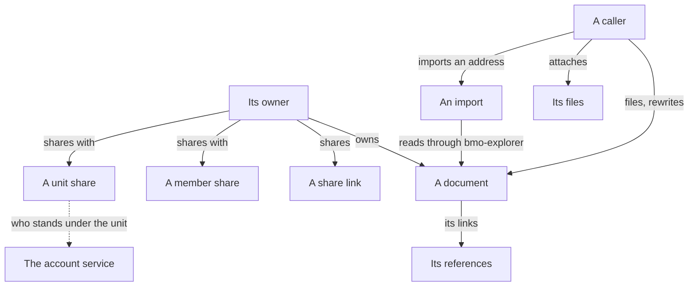

# The documents

This is the canonical design statement of bmo-artifact. The code is one realisation of it. `docs/api.md`
is the boundary this design is reached through, and `docs/layout.md` is where its parts sit in the
repository.

## What the service keeps

- **Documents a caller files for a person to read later.** A record, study material, a web page brought
  in whole, or an HTML page kept as it stands.
- **The files beside each document.** Pictures, sound, video, text files and any other file, shown or
  played where the document is read.
- **The pages each document refers to,** with what each page says of itself for a preview.
- **Each document's owner,** the account that filed it, which alone reads it until it shares it, but for the
  administrator, who reads every document (「Owners」).
- **Share links,** each opening one document for whoever holds it.
- **Member shares,** each opening one document to read to one member of the owner's company.
- **Unit shares,** each opening one document to read to everyone standing in or under one organisation unit of
  the owner's company.
- **The reads of the last seven days,** each one reader's day on one document and when that reader last opened it
  that day, by which the screens rank the documents most read and list the documents a reader read last
  (「Reads」).
- **Nothing it did not keep.** It runs no research and speaks no narration: a research run is a client's
  own work that files its result here, and a narration is a sound a client attaches with the role `head`.
  It knows no caller: a document's `scope`, `actorName` and `labels` are the caller's own strings. It keeps no
  organisation: which unit a person stands in, and which company a unit belongs to, is asked of the account
  service each time it is needed, but for the company a document was filed under, which the document keeps
  with the place its files stand at (「Places」).

## Kinds

Every document has a kind, and the kind decides how it is filed and read.

- **Each kind is its own module.** Each answers one shape: its name, a sentence saying what it is, whether
  it is the HTML page it keeps, how many levels of its headings a table of contents lists, and the icon the
  screens draw it by, a name of the Material Symbols set.
  - One catalogue lists the modules, in the order `GET /document-kinds` answers them.
  - The routes and the console bundle ask a document's kind, and never branch on a kind's name.
  - Adding a kind is adding its module and its line in the catalogue.
- **`search`**: what a research found, as a markdown body in the shape the researcher writes it: the core
  answer, the three-line summary, the findings in the sections the question shapes, and what could not be
  confirmed. Its references are the pages the findings rest on. Its contents are its headings, to two
  levels: a section and the parts inside it.
- **`record`**: data put in order and kept, as a markdown body. Its contents are its headings, to two
  levels.
- **`learning`**: study material laid out as a book, as a markdown body. Its contents are three levels: a
  top heading is a part, the one under it a chapter, the one under that a section.
- **`import`**: a web page brought in whole (「A page imported whole」). Its contents are the page's own
  headings, to three levels.
- **`page`**: an HTML page kept as it stands (「An HTML page」). It is filed as its HTML and opened as that
  page wherever it is opened, so it has no contents.
- **A row whose kind no module answers reads as `record`,** so a document filed before the catalogue knew
  its kind is still answered and listed among the records.

## Where it lives

A document is rows of this service's PostgreSQL database and files at its place: the file root on this
machine, or the place the owner's company chose (「Places」). The database's address and the file root are
settings; no other unit reads or writes the database, and no other unit writes a document's files.

- **The rows are the identity:** the list, the filters and the search are read from them.
- **The file is what a person reads:** the markdown as filed, or the HTML.
- **A row that left no document is no document.** A row that names no file, or is marked as having
  written none, as a research run that failed, died or found nothing, is never listed and is read as
  absent on every route; its number is not given again.

### The tables

| Table | One row per | What it holds |
|---|---|---|
| `searches` | document | its kind, title, scope, actor, owner, labels, description, its file's path, the company and the place it was filed under, and its times |
| `search_findings` | piece of a document's body | the body's words the search reads; a document filed here keeps its body as one piece |
| `search_sources` | reference | the page's address and title, and the piece of the body that refers to it |
| `archive_attachments` | kept file | what it is read as, its type, size, name, role, path and when it was kept |
| `search_images` | picture kept before the attachments held pictures | read once into the attachments, never written |
| `web_search_shares` | share link | its token, its document, when it was made and when it ends |
| `web_search_share_notes` | link that has ended | its token, what it opened, that document's title, when it ended and why |
| `artifact_member_shares` | document shared with one member | its document, the member's account key, the permission and when it was shared |
| `artifact_unit_shares` | document shared with one organisation unit | its document, the unit's number as the account service keeps it, and when it was shared |
| `artifact_reads` | one reader's day on one document | its document, the reader, the day and when the reader last opened it that day |
| `imports` | import | the address asked, the title, scope, actor and owner asked, its state, its document or why it failed |
| `events` | event | its kind, when it was kept, the scope of its member and the member |

- **The tables keep their names and their old columns,** since the documents a deployment brings in from
  an earlier archive keep their numbers, paths and share links on them. A migration a database may already
  have run is never rewritten or removed; a change of shape is a new migration.
- **A document's times:** `started_at` and `finished_at` are epoch seconds, as the earlier rows keep them;
  `changed_at` is epoch milliseconds. A document is answered in milliseconds.
- **A document filed here fills the earlier required columns** with its own values: the title as its
  question, its kind as its depth, the state `done`, and its moment of filing as both its start and its
  end.
- **A row filed before the scope was kept** carries its old grouping number as its scope, in decimal, and
  its writer as its actor.
- **Settling.** Once in each process, before the first statement on the document tables, a row that names
  no kind is given one (`import` where its question opens with the prefix the settings name, its old kind
  otherwise) and a writer, and the pictures of `search_images` not yet among the attachments are copied
  there. `migrate` does not settle, since it may run before the tables exist.
- **A share link's times are epoch seconds** in its row, and milliseconds on the wire.

### Places

- **A place is where a document's files are kept,** reached through one interface: a file written whole at a
  location, a file read whole or in one byte range, a location let go of with everything under it, and whether
  a location holds a file, with its size and a version that changes whenever the file is written.
- **Each kind of place is its own module.** Each answers its name, a sentence saying what it is, the settings
  it takes, how it judges a value naming it, and how it opens over a value it judged.
  - One catalogue lists the modules, in the order `GET /storage-places` answers them.
  - Nothing else names a kind: adding a kind is adding its module and its line in the catalogue.
- **A file's path names its place and its location,** `<kind>:<location>`: `local:searches/42/document.md`
  on this machine, `sharepoint:<site>/<drive>/<folder>/document.md` in a document library. A path that names
  no kind is a location of the local place as it stands, so the files kept before places were named are read
  where they are and never moved.
- **The place is chosen when a document is filed,** by the setting `artifact.storage` of the account
  service's delegation chain, resolved for the document's owner (「The setting」).
  - A document with no owner, an owner the account service does not know, a chain that says nothing, and a
    service whose settings name no account service, all file at the local place.
  - Where the account service is named and fails, the filing is refused and nothing is written, so a document
    whose company keeps its files elsewhere is never left on this machine instead.
- **A document keeps what it was filed under:** its owner's company, the first unit of the owner's chain, and
  the value that chose its place. Its file and every attachment stay at that place for the document's whole
  life, a rewrite writing its file where it stands, so a change of the setting reaches the documents filed
  after it, and reading a document asks nothing of the account service.
- **Serving stays this service's.** Every read of a document's file or an attachment, in the console, through
  a share link or through a reading, is answered here as before: the bytes are read at the document's place
  and sent on as they come, a range asked passed to the place, and the links and who may read them are the
  same whatever the place.
- **Letting a document go lets go of its folder at its place,** after its rows; a place that cannot be
  reached then leaves its files there.

### The setting

- **`artifact.storage` is a setting of the account service's delegation chain** (bmo-web's `docs/accounts.md`,
  「The delegation chain」), declared by this service as its server stands, and again where a resolution finds it
  undeclared: a `json` value, `nearest`, at the platform and at units, a unit's link written by its heads, with
  no default.
- **Its value is an object** naming the kind in `place` and that kind's settings beside it, as `{"place":
  "local"}` or `{"place": "sharepoint", "site": …, "drive": …, "folder": …}`. Its link's value is written by
  this service alone, after the kind judged it (docs/api.md, 「Storage places」), in the name of the person
  writing it, so who may write a link and a lock above it are the account service's word. Its delegation is
  written on the chain's own route, as any kind's is: a company that locks it decides it for every unit under
  it.

### The local place

- **The kind `local` keeps a document's files under the file root on this machine,** and takes no settings.
- **A document's folder** is `searches/<document id>/` under the file root.
  - A markdown document's file is `document.md` in it; a page's is `page.html`. The row names the file by
    its whole path, so a document's file never moves.
  - Every attachment is kept under `attachments/` in it, named by a digest of its name and its own name.
- **Previews** of the pages documents refer to are kept under `web-cache/` whatever a document's place.
- **Every file is served only from inside the file root,** every link resolved.

### The SharePoint place

- **The kind `sharepoint` keeps a document's files in a SharePoint document library,**
  through Microsoft Graph. Its settings:
  - `site`, the Graph id of the site, and `drive`, the Graph id of its document library;
  - `folder`, where a document's folder stands in the library: a path whose `{login}` is the owner's login and
    whose `{document}` is the document's number, which it names at least once, as `04. BMO_ARTIFACT/{login}/
    {document}`;
  - `account`, the account the token is lent for, where it names one; the document's owner where it
    does not.
  - A value with another field, a site or drive holding a `/`, or a folder that climbs out of the library or
    names no `{document}`, is refused.
- **A document's folder** is the folder its settings lay out, the owner's login asked of the account service as
  the document is filed; its file and its attachments stand in it as they do in a local folder.
- **A file is written whole,** one call up to 4 MiB and through an upload session in parts above it, replacing
  what stands at its location; the library makes the folders on the way. A read is the library's content read,
  a range asked passed on, the bytes taken from the address the library sends it to; whether a file stands, its
  size and its version are its item's. Letting a folder go lets go of everything under it.
- **The token is borrowed for a person** through an optional page-token service's page token road (docs/api.md,
  「What this service calls」), for the account the settings name, else the owner, with `Files.ReadWrite.All` or
  `Sites.ReadWrite.All`. It reaches the library as that person, so the person must reach the library and the
  page-token service must be able to lend their token; otherwise the call is refused as a failed upstream, saying
  why. The token is kept in memory until a minute before it ends and written nowhere.

## Filing a document

- **The kind decides what is filed.** A `page` takes HTML and no body; every other kind takes a markdown
  body and no HTML.
- **Nothing is written for a refusal.** The kind, the title, the body or HTML and the actor are checked
  before the row exists, and the row, its body, its references and its file are written together: the file is
  written at the document's place before the rows are committed, and a place that refuses it refuses the
  filing, with no row left.
- **The title** is the one given; a page whose title is left empty takes its own `title` element, and a
  page with neither is refused.
- **The description** is what the document reads as before it is opened:
  - the one the filer gives, cut like the others, where it gives one;
  - else, for a markdown document, the opening prose of its body as plain words, headings, pictures, code and
    tables left out, cut at a space near 160 characters and marked as cut;
  - for a page, its description meta, else the start of its words cut the same way.
- **The references** of a markdown document are each distinct http or https link its body makes, in the
  order it makes them, titled by the words the link is written as.
- **A rewrite** keeps the document's number, its attachments and its share links. Its labels are replaced
  whole; a title, body or HTML given replaces its own, and a new body's references replace the old ones.

## Attachments

- **What an attachment is:** a copy kept under the document's own folder, of what was handed over in the
  call.
- **What it is read as is read from its bytes and its name,** not taken on the caller's word.
  - The bytes decide first; the name decides between the forms one container holds, as an Ogg or a WebM
    is a sound or a video by what it was called.
  - A text is what decodes as UTF-8 with no NUL in it. A text whose name ends in `.html` or `.htm`, or
    whose first tag is a doctype or `html`, is a page.
  - Where the bytes say no more than a plain text or a bare file, the type the caller gave is kept.
- **A picture is kept as AVIF, upright,** inside 2048 pixels. A picture that will not convert, and a GIF
  or a WebP that may be animated, are kept as the bytes that came.
- **A body draws a kept picture by its name:** a markdown picture whose target is the name the file is
  kept under, or a path with no scheme whose last part is that name, is drawn from the kept file, and a
  link written either way opens it. A web address is never read as a kept name. A reader resolves the
  name under the route it reads the document on.
- **The role is the caller's word for the file's part.** `head` marks a file a reader is shown at a
  markdown document's head; a narration's sound is attached with it. A page stands its sounds where it
  writes them (「An HTML page」).
- **A name may carry a language** as its last part, a two-letter language code after a hyphen and before
  the extension, as `narration-ko.ogg` and `narration-en.ogg` do. A code no language is known by is no
  language.
- **Bounds:** one file is at most 64 MiB through the API, and a document keeps one file of each name.

## References

- **A reference is a page a document refers to,** kept as a row with its address and title.
- **A preview** is what the page declares for a link's card: its title, its description and its picture.
  It is read through bmo-explorer's client, which checks the address and paces each host, for a caller who
  is not to reach the outside server itself.
- **What is read is kept** under the file root: a preview for a week, a picture for a month, a failure for
  a day, and a read that ran out of time not at all. One read of an address runs at a time; a second
  asker waits for it and takes what it kept.
- **The list answers what is kept,** so listing never reaches the web; reading one reference reads its
  preview where none is kept fresh.

## Owners

- **A document's owner is the account that filed it.** The account is the one the filing call names in
  `Owner-Key` on the service's token (docs/api.md, 「Readers」), never a field of the body: a caller's body is its
  own word, and the header is set by whoever holds the service's credential.
  - **A supervisor files for its user as that user.** Agency holds the account a supervisor of an account works for in
    its program's `BMO_OWNER_ACCOUNT`; the MCP server and the archive verb, started in that program, name that
    account on every call, so what the supervisor files is its user's and what it reads is what its user reads.
  - **A caller naming no account files a document with no owner:** a research run, a supervisor of no account and
    any other service. A row that keeps no owner reads as such a document.
- **A new document is its owner's alone.** Its owner reads it, rewrites it, attaches to it, lets go of it and shares
  it; no other account but the administrator reads it until it is shared, not even the head of the owner's unit.
  Lists, searches, label counts and the share links listed hold only what a reader reads, and a document a reader
  does not read answers as one that does not stand, so its number tells them nothing.
- **The administrator reads every document,** as the platform's superadmin reaches everything and changes nothing
  of another's (`STRUCTURE.md`, 「Accounts, companies and units」): of every company, owned or not, shared or not, in
  lists, searches, label counts and the share links listed as in each document's own reads. The administrator's read
  of another's document leaves nothing its owner can see.
  - **A document with no owner is the administrator's wholly,** read, shared and changed by the administrator alone
    among the accounts.
  - **A document another account owns the administrator reads alone,** under `read` as a share's reader does:
    rewriting it, attaching to it, letting go of it and sharing it stay its owner's.
- **A caller holding the service's token and naming no account reaches every document,** owned or not: the
  services that file, settle and let go of documents.
- **A document is shared three ways, each by its owner** (the administrator for a document with no owner): a share
  link, a member share and a unit share, each standing on its own terms and none ending another.
  - Whoever reads a document through a member share or a unit share, and the administrator reading one another
    account owns, reads it alone: never rewrites, attaches, lets go of or shares it on.
  - **Everything shared stays within the owner's company:** a member share and a unit share name an account or a
    unit of the company the owner stands in, as the account service answers it when the share is made, and one of
    another company is refused. A share link opens the document to whoever holds its token, wherever they stand.
- **An owner who leaves** keeps their documents: what was shared stays read through its shares, and what was never
  shared is sealed, since the departed account signs in no more and no other account but the administrator reads
  it.

## Share links

- **A link is a row rather than a signature:** a link is read back long after it was made, and ended
  before its time, neither of which a signed capability can do.
- **The token is the link entire:** eight random characters of the URL-safe alphabet (six random bytes in
  base64), from which nothing is derived, naming the one row it was written for; a token that meets one
  already kept is drawn again. A token of eight to 128 such characters is one shaped as issued here, and any
  other opens nothing.
- **A document has at most one live link.** Asking for a link where one stands answers the one that
  stands, so a link somebody is still handing out is never quietly replaced.
- **A link ends at the second its time falls in,** never before. Every read and every making sweeps away
  the links whose time has passed.
- **A link that has ended leaves a note of what it opened:** its token, the document, that document's title,
  the second it ended and why it did, held where no live link stands. A link ends by its time passing, by a
  caller ending it, or by its document being let go of, alone or with its scope, and each of the three leaves
  the note before the link goes, so the row and the link are never both lost. The token then answers what stood, and
  never nothing at all (docs/api.md, 「Share links」). A note says what stood, never what it said: the body is
  the document's, and a note outlives it.
- **A document with no end is the ordinary hand-over:** `POST /publications` files a document and opens its
  link at once, with no end, so the link a reader is handed keeps opening across the service's restarts and
  redeployments, and keeps serving the body a rewrite leaves it standing with.
- **A link's address** is the share address the settings name, a `/` and the token. What answers that
  address is whoever serves the service to a browser: it reads the link, then the document, its content, its
  files and its references through the share reads, each carrying the token (docs/api.md, 「Share links」).

## Member shares

- **A document is shared with members of the owner's company** as well as by link, from the one share dialog
  (「Where a person reads it」). A member is an account of the console's people directory, every account under
  the company the reader's own unit belongs to; the service keeps each member by the account key alone.
- **Sharing an owned document asks the account service each member's company** (docs/api.md, 「What this service
  calls」), and a member whose company is not the owner's, or whom the account service does not know, is refused
  before anything is stored. A document with no owner is shared by the administrator as the console's directory
  offers, with no company asked.
- **A member reads and does nothing else.** The permission is `read`, the one a member is given; the screens write
  nothing to a document, so no share gives more, and `edit` is refused. A member reader neither makes nor ends
  a link, nor shares the document on.
- **Each change stands as it is made.** Sharing, changing and taking a member off are each stored on their own;
  a member taken off reads nothing of the document from the next call on.
- **A member share goes with its document,** when the document or the scope holding it is let go of, and leaves
  no note: unlike a link, a member share was never handed to anyone outside to open.
- **A link stands beside the member shares,** each on its own terms: a share link opens the document to whoever
  holds its token whatever members it is shared with, and ending a link touches no member share.

## Unit shares

- **A document is shared with an organisation unit of its owner's company,** and everyone standing in that unit
  or in any unit under it reads it. Sharing with the company itself, the unit at the top of its tree, opens it to
  the whole company. A unit of another company is refused, and so is a unit the account service does not know.
- **The service keeps the unit by its number alone.** Which unit a reader stands in, and the units above it up to
  their company, are asked of the account service as the reader reads (docs/api.md, 「What this service calls」),
  so the tree is never copied here:
  - a person moved to another unit reads by the unit they stand in now, from their next call on;
  - a unit share taken away stops every reader who read only through it at once, while one who reads through
    another share, or owns the document, keeps reading.
- **The owner picks the unit from its company's tree,** which the service reads from the account service for the
  share screen each time it is asked and keeps none of (docs/api.md, 「Unit shares」).
- **A document with no owner is shared with no unit,** since it belongs to no company.
- **A unit reads and does nothing else,** as a member does: its readers read the document under `read`.
- **A unit share goes with its document,** as a member share does, and leaves no note.

## Reads

- **A read is one reader opening one document on one day.** The document's screen keeps one each time it opens a
  document, for the account the console signs the reader in as; a share page keeps one for the browser it runs
  in, by a token of its own that browser keeps and sends with the read. A reader who opens the document again the
  same day keeps no second read, so a reload or a return counts nothing more; the read only moves to the moment
  of the latest opening.
- **Only the last seven days are kept.** Keeping a read lets go of every read older than that, so the table
  holds a week of reads whatever the traffic.
- **The documents most read** are those with the most reads in the seven days, the newest first among equals.
  A reader is shown only the documents it reads (「Owners」).
- **The documents read last** are one reader's own: the documents that reader opened in the seven days, the one
  opened last first. Nobody is shown another reader's, and of its own a reader is shown only the documents it
  still reads (「Owners」).
- **A read is no change of the document:** it raises no event and leaves the document's times as they stand. It
  goes with its document when the document is let go of.
- **Nothing else counts as a read.** A caller reading a document through the service's token or the MCP server,
  a chat app drawing a link's card from the share head, and the server rendering a share page before the browser
  runs keep none.

## A page imported whole

An import brings a web page in as a document of kind `import`, read as it stands: nothing is
researched, summarised or reordered.

- **The page is read after the caller is answered.** The import is `fetching` until it is `filed` with its
  document or `failed` with why; an import a stopped process left `fetching` is `failed` when the service
  starts again.
- **The page is read as served,** through bmo-explorer's client: its markup, at most 512 KiB of it, after
  every redirect. No script runs, so a page that draws itself with a script is read as its markup stands.
- **What is read:**
  - every link and picture address made absolute against the address the page was read at;
  - the title asked for, else the page's first `h1`, else its `title`, else its host;
  - its main content, the `article`, else `main`, else the body, written as markdown by a maintained
    converter, its navigation, footers, forms, scripts and styles left out.
- **Every figure where it stood:**
  - a picture is fetched through the client and kept as the document's file, named `figure-<n>` by its
    place among the page's figures;
  - an inline SVG drawing is kept as its own source, redrawn as a picture like any kept picture;
  - a figure that could not be kept stands as the wording file's line naming its number and its caption;
  - at most 40 figures are kept, and a picture written into the page as data, with no address to read,
    is left out.
- **Its references:** the page it was read from, titled by the document's title; the address asked for,
  where the page moved on from there; and each page of another host its body links to.

## An HTML page

The service hosts HTML pages the way a static host does. A page document is its HTML file: what goes out
is that file with the design and the reader's scheme put in front of it, and nothing is written in its
place.

- **Filing it:** the page is filed as its HTML, untouched. A page carries what it draws inside itself or
  over https, so it takes no body; files may still be attached beside it.
- **A page's sounds play in the design's player, where the page writes them.** A sound the page keeps beside
  it is attached to its document, and the page refers to it by the name it is kept under, as an `audio`
  element whose address is `attachment:` and the name, percent-encoded where the name needs it:
  `<audio src="attachment:narration-ko.ogg"></audio>`, or a `source` inside the `audio` so written. An
  address over https is taken as it stands. What the page writes around the element — a band, a heading, a
  label for each language — stays as the page wrote it; the reader draws no band of its own over a page.
  - **Each `audio` element is stood in its place as the design's player,** bmo-ui's audio player element,
    `bmo-audio-player`, keeping every attribute the page gave the `audio` element but its address and those
    only the browser's own player reads (`controls`, `preload`, `autoplay`, `crossorigin`), so a
    `data-language` or a `class` the page selects it by still stands on it.
  - **The player answers `play()` and `pause()`** as the `audio` element did, so the page's own script moves
    it as before, found by any attribute but the element's name. One sound plays at a time across the page.
  - **It is named** by the element's `title` where the page gives one, else by the kept file's name, and
    downloads the kept file.
  - **It speaks the reader's language,** in the words the console bundle's pack gives the player, and is
    drawn in the scheme the page is drawn in.
  - **The address a sound plays from** is one the sandboxed page can load: on a share link, the share route
    of the attachment; on the console's own reading, a reading address (「Readings」). A name the document
    keeps no file under leaves the player saying it cannot be played.
  - Each `audio` element's address is rewritten as the page is read, before the browser asks for it, so a
    kept file is only ever asked for at its loadable address; where the player's script cannot be loaded,
    the element stays the browser's own at that address.
- **Reading it:** `bmo-artifact html-read <file>` gives a page's title and its words in order, a block to a
  line, headings as markdown headings and list items as dashes, scripts and styles not words.
  - Every picture written inside the page as a data address stands in the reading as a markdown picture
    named `picture-01` and onward; `--stem` names them otherwise, and `--pictures <dir>` writes them out.
  - The words are cut at the answer ceiling, and `--from` carries on at the line the cut names.
- **Its design is the service's where it brings none.** The design's page sheet and the reader's scheme
  go ahead of the page's own lines. What they do depends on what the page brings:
  - **No stylesheet of its own:** the page is drawn wholly in the design: the reading column, the
    masthead, the type, the tables, the boxes, and the palette of the reader's scheme.
  - **A style element marked `data-archive`:** an addition to the design, drawn in the design's colour
    variables, so it follows the scheme as well.
  - **Its own stylesheet, with no dark scheme declared:** the page keeps its layout and every part it
    names by a class or an id, and takes the design's type in the light palette over what it wrote for
    bare elements; where the reader's scheme is dark, it is drawn inverted with its hues turned back, and
    its pictures and films inverted again.
  - **A dark scheme of its own:** the page draws itself in the reader's scheme.
  - **A page's questions about the scheme are answered with the scheme it is drawn in:** a rule asking
    `prefers-color-scheme` and a script's `matchMedia` asking it, a diagram's library choosing its theme
    among them, read the reader's scheme on a page in the design or with a dark scheme of its own, and light
    on a page drawn inverted, which is drawn light and turned. The root's `color-scheme` says the same. A
    reader whose scheme is whatever the system asks leaves the questions to the system, but on a page drawn
    inverted.
  - The sheet stands before anything the page draws, so the first paint is already in the scheme.
  - **Exactly one sheet goes out, the reader's.** Lines an earlier serving put ahead of a page — the sheet,
    marked `data-archive-sheet`, and each line marked `data-archive-prelude` — are left out of what goes out
    where a page was filed carrying them, and are never read as the page's own design.
- **The parts a page builds with.** A page written on the design is plain HTML in a body the sheet lays
  out, drawing headings, paragraphs, lists, tables, quotations, code, figures and folds as a markdown
  document's, with these named parts beside them:
  - a `header` opening the body as the masthead, with an `eyebrow` line over its title and a paragraph
    under it saying what the page is;
  - a `lede` box for the key answer;
  - an `aside` for a note, toned `ok` or `warn`;
  - a `chip` for a short state, toned `ok`, `warn` or `bad`;
  - a `grid` of boxes side by side, which fold to one column on a phone;
  - a table, which scrolls sideways inside itself where it is wider than the column;
  - a `footer`, which closes the page in the muted ink.
- **Hosting it.** The page goes out on its document's content route, and an HTML attachment on its own.
  - What goes out is the file as kept, with only a few lines ahead of it: the sheet, the line answering its
    questions about the scheme, one that lets its copy buttons work in the sandbox, one that hands a pressed
    picture to its frame (「Pictures open whole」), one that opens a link the page opens in its own window
    in a tab of its own, and, where the page writes an `audio` element, the player's script and the line
    that stands each sound in it. A download is the file itself.
  - **Sandbox:** it runs its own scripts, sandboxed, with an opaque origin of its own. It submits no form,
    loads what it is drawn with from inside itself or over https, opens no connection but to the address
    it was served from, where only what answers any origin can be read — a sound's bytes for the player's
    waveform — and reaches nothing of the screen it was opened from.
  - **Framing:** it may be framed by the screen that opened it, and by no other site.
  - **One sandbox for both.** The sandbox, the rest of the policy and the lines that go ahead of the page
    are kept in the design's files; the server sends the page under them, and the console bundle's frame
    gives the page the same sandbox.
  - Every other attachment goes out under the policy that lets nothing on it run. An attachment read on a
    share link or a reading answers any origin, so the player in a sandboxed page reads its waveform.

### Readings

A page the console's own reader opens stands in a sandbox of its own origin, which carries none of the
reader's sign-in, so its sounds are handed to it on addresses a token opens.

- **A reading token** is the document's number and the second the reading ends, signed with the service's
  key, in URL-safe base64. It is written into the page's lines each time the content route serves a page
  that writes an `audio` element to the console, and nothing of it is kept: a token whose signature does not
  hold, or whose time has passed, opens nothing.
- **A reading lasts twelve hours,** and opening the page again writes a new one.
- **The key** is drawn from the service's token where the settings name one, so a reading outlives a
  restart; with none, one is drawn as the process starts.
- **What a reading opens:** that one document's attachments, as the share reads open them, an HTML
  attachment as a hosted page whose sounds are handed the same reading.
- **The player's script** goes out on its own address named by the digest of its bytes, open to anyone
  and kept by whoever loaded it; a page of a share link and a page of a reading load the same one.

## How a document is drawn

One design draws every document, a markdown one and a page alike, in a light and a dark scheme. The
design is data files of this repository under `client/design/`, which the server reads to write a page's
sheet and the console bundle reads to draw a document.

- **The palette** is one set of document colours per scheme: a warm paper with a raised and a sunk
  surface, the ink in three strengths, a rule and a softer one, an accent, and a calm and a caution tone.
- **The reader's scheme** is light, dark, or whatever the reader's system asks. The request names it; a
  request that names none reads in the design's default, dark.
- **The masthead:** the kind's label over the title in the accent, the title bold at the console's section
  title step, 24px at every width, across the reading width, breaking only between words unless a word has
  no break in it, and a rule in the ink closing it.
- **The headings follow the console's type scale,** one step under the title: a page's own top heading is the
  title at 24px, a section 20px, a part of one 18px, and anything deeper the body's 16px in bold, at every
  width; a markdown body's sections stand at 20px under its 24px masthead title.
- **The body:** 16px words on a loose line; a section ruled off under its heading; a quotation a box on
  the sunk surface with an accent rule down its left; a table a rounded box on the raised surface with its
  head row on the sunk surface; code on the sunk surface; links in the accent.
- **The listen band is the reader's, for a markdown document.** The sounds heard at its head stand in it,
  each in the design's own player, under its masthead. A player plays its sound through the attachment route
  the screen reads the document on, the share route on a share page, which answers a ranged read. A document
  with no such sound has no band. A page has no band of the reader's: its sounds stand where the page writes
  them (「An HTML page」).
  - **What stands in it:** every sound with the role `head`, and, beside a head sound whose name carries a
    language (「Attachments」), every sound named as it is with another language in that place, in the order
    the files were kept.
  - **Each sound is labelled** with the language its name carries, in that language's own words; a sound
    whose name carries none stands with no label.
- **Diagrams** in a markdown body are fenced `mermaid` blocks, drawn in the design's colours; in a page,
  inline SVG in the page's own colours. A diagram names no colour of its own, so it is right in both
  schemes.
- **Footnote marks** cite the pages a markdown body rests on, as a research's body does.
  - **A mark** is a number in square brackets, with a dagger after the number where the value was read only
    in a search's snippet, written straight into the text, or written as a link to `#mark-` and the mark's
    name.
  - **A source entry** is a list item that opens with a mark and goes on with a link to the page, as the
    list closing a research's body has one for each mark. A bare bracketed number is a mark only where the
    body carries an entry for it, so a number in brackets anywhere else stays as it is written. The body is
    drawn as filed; nothing in it is rewritten for its marks.
  - **In the text** a mark is a raised number, bracketed as written, at the caption size, in the accent,
    and in the caution tone where it carries a dagger. **In its entry** the mark is a link in the accent at
    the text's size, which scrolls the text back to where the mark first stands and marks it there for a
    moment.
  - **A mark brings its source forward,** the way a wiki's footnotes do: the mark, then the entry's words
    formatted as the body formats them, the address of the page as a link that opens it in a tab of its own,
    and, for a dagger, that the value was checked against the snippet only. A mark with no entry opens nothing,
    and nothing a mark is pressed with follows its link, so the address never changes.
    - **A pointer resting on the mark** opens it in a popover over the mark: centred on the mark with a
      point toward it, as wide as its words up to 40rem, above the mark, and below only where there is no
      room above. It stays while the pointer is on the mark or inside the popover, and goes once the pointer
      has left both. A key pressed on the mark opens the same popover.
    - **A click on the mark** scrolls the text to its entry and marks the entry there for a moment.
    - **Each jump a click makes,** to an entry or from an entry's mark back to the text, is a step the back
      gesture takes back: the text returns to where it stood before the jump, and the reader stays on the
      document, the address unchanged.
    - **A tap on the mark** opens it in a dialog centred on the screen over the dimmed page, with a close
      button under it, and moves nothing: the text does not scroll and the page under the dialog stays
      still while it stands. The close button, a tap outside the dialog, Esc and the back gesture put it
      away.

## Pictures open whole

A picture in a document opens in the picture viewer, for a markdown document and a page alike.

- **What opens it:** a plain press (the main button, no key held) on a picture the document draws, or on
  a picture's row among a markdown document's files (「The files after the body」). The viewer stands the
  picture whole over the screen, to zoom, move and pinch, and steps to the document's other pictures.
- **The run it walks,** from a picture in the document, is every picture of the document that would open
  it, in the order they stand; a picture that is not drawn is not in it. From a row among the files it is
  every picture among those files, in the order they were kept. Either run is cut to the stretch around
  the pressed picture where the document holds more than one run carries.
- **What stays with the document:** a picture inside a link, a button, a label or a fold's summary; one
  that answers a press of its own or stands in an element that does; a press the document's own script
  has handled; and a picture marked `data-archive-no-viewer` or standing in an element so marked.
- **A page asks from inside its frame.** The lines ahead of the page's own read its pictures by the same
  rule and hand the run to the frame as one message, which the frame takes only from that page and only
  for pictures over the web or written into the page as data. The page's file is never touched for this.
- **One rule for both,** kept in the design's file, which the console bundle and the page's lines both
  read.

## A picture drawn small

A kept picture the body draws smaller than it is kept, and a document's cover, are drawn from a copy made near the size they stand at.

- **Why:** a browser shrinks a picture by halving it as many times as fit and sampling the rest with no
  filter, so a picture drawn between one and four times smaller than its file breaks into jagged edges
  and ripples, and no stylesheet setting changes how it filters. A body column draws a kept picture of up
  to 2048 pixels at a few hundred, the very span where it shows most.
- **The copies:** the attachment routes answer a `width` asked of a kept picture with the picture shrunk
  to the first step of one ladder at or above it, filtered with a Lanczos kernel, as JPEG where it is
  opaque and PNG where it is not. The ladder starts at 16 pixels and each step is at most a quarter wider
  than the one before, up to 2048. A width at or past the picture's own, a GIF or a WebP, which may move, a
  file that is no picture and a download go out as kept. The copies made last are kept in memory within a
  bound, under the file and the moment it was written.
- **The choice:** once a kept picture the body draws has loaded, where it stands more than a quarter
  smaller than its file on the screen's pixels, it names the steps below its own width as the widths it can
  be drawn from, and the width it stands at; the browser draws it from the first covering that width at the
  screen's density. Its own file is no candidate, since a browser keeps drawing a candidate it already holds
  at a higher density than it needs. It keeps the width it stood at. A picture the body draws from the web,
  and a page's own pictures, are drawn as they come.
- **A cover is asked at its box:** a document's cover fills a box of its own shape on the front page and in
  the list, cropped to it, so it is asked at the width that covers the box on the screen's pixels: the box's
  longer side before the picture has loaded, and, once its shape shows it is wider than the box, the box's
  height times that shape. Nothing is fetched before the box is measured. The cover route answers that
  width with its card's copy at the ladder's step, kept as a kept picture's copies are; a link's preview
  card asks no width and gets the card whole.
- **The viewer opens the kept file:** a picture drawn from a copy opens whole from its own address
  (「Pictures open whole」), the bytes as they were kept.

## The files after the body

A markdown document's files stand after its body, on the console's screen and on a share page alike, in the
order they were kept: every file it keeps but a sound heard in the listen band. A picture the body draws by
its name stands among them too, so it can be saved.

- **Each file is one row:** its kind's icon, its name, its size and what it offers — every row its saving,
  and a page its opening in a tab of its own. A sound's row is the console's own player, which carries its
  name, its size and its saving; a film plays under its row where it stands; a text shows its start under
  its row.
- **A picture's row leads with the picture,** filling a square at the console's avatar size in place of the
  kind's icon, read once it comes into view; the kind's icon stands in where it does not load. No picture is
  drawn large in the list, so a picture the body draws is drawn large once, in the body.
- **A plain press on the picture or its name opens it whole** in the picture viewer (「Pictures open
  whole」), which steps through the pictures among the files. The picture and its name are one button, named
  for opening that picture in the language pack's words, so a key reaches it as any button.
- **A row holds to the list's width at every width;** a long name is cut at the end of its line, and the
  list never scrolls sideways.

## Where a person reads it

- **The console bundle in `client/`** draws the documents under the name Artifact (`docs/layout.md`, 「The
  console bundle」):
  - the front page at `/artifact`, the documents at a glance (「The front page」), standing while the address
    narrows nothing;
  - the list at `/artifact` once the address narrows it, by kind, by category or by a phrase, or names the view
    `list`, each narrowing held in the address. Its bar holds, at its leading end, the way back to the front page, an
    icon button named 「Back」 (`artifact.action.back`) in its tooltip, then the search, which takes the width the rest
    leaves it, then the kind and category filters and the refresh. Each filter is bmo-ui's one select
    (bmo-ui's `docs/components.md`, 「Choosing a value」), so its list offers a search once it holds more than
    seven choices and never with seven or fewer. The filters stand at the bar's trailing end, so each list opens
    against its select's trailing edge and stays on the screen. A bar short of the room every bar of the console
    gathers under (bmo-ui's `actionbar`) keeps the search and the refresh standing and folds the two filters into
    one filter popover at the row's end, against the button's trailing edge: each filter's select under its
    name. A choice made in the popover puts it away before the address takes the
    narrowing: the narrowing must land on the list's own history entry, never on the one the popover's back step
    stands on, which Back would take away with it. The popover's button is named in its tooltip by the pack's word for filters
    (`artifact.label.filters`) and stands pressed while either narrows the list, so a phone's search
    keeps the width to read what is typed in it. Each document stands with its cover
    picture at the row's leading edge where it keeps one, and alone where it keeps
    none. A row is the document's number as `#<id>`, its title, its description, how many files it keeps and
    the day it was filed, and at most four badges: its kind, its category where it carries one (「A document's
    category」), what it still lacks where it lacks something (「A document that lacks a part」), and,
    at the row's trailing edge right of the day, whether it is public: public while a link to it stands,
    naming the day the link ends where it has one, and private where none stands. The number
    is copied by pressing it, which opens nothing, and a phrase that is a number, with or without its `#`, finds
    the document of that number. A document's other labels — the keywords, the rule, the question, the run a
    filer names it by — are search metadata, no part of a row and never a badge anywhere in the list: a phrase
    still finds a document by them. A row holds to the list's width at every width; its words wrap or are cut,
    and the list never scrolls sideways;
  - one document at `/artifact/<id>`: the screen's own row under the bar, one line at every width, holding at its
    left end the way back, named 「Back」 (`artifact.action.back`) in its tooltip, to where the reader came from, the
    front page or the list as it was narrowed, and the front page where the reader came from no screen of these,
    then the document's number as `#<id>` and, for a page, its kind; and at its right end all that acts on the
    document, so no
    action on it stands anywhere else on the screen: the translation toggle where a markdown document is written in
    another language than the reader's (「A document written in another language than the reader's」), then the
    actions on the document as one group, opening its instruction where it carries one, then for a markdown
    document its referred pages where they do not stand beside it, saving its file, sharing it and its
    properties, and for a page opening it in a tab of its own, saving it, sharing it and its properties; a group
    of four or more folds into one menu, and three or fewer stand as icon buttons named in their tooltips. Then a
    markdown document's masthead — its kind, its title, what it still lacks where it lacks something (「A document
    that lacks a part」), its labels but its instruction and what it lacks on a secondary line under the title,
    each name and value, that wraps, and no action and no line under the title but these and what its translation
    says of itself — its file drawn as markdown with
    a table of contents of its kind's depth, its files after it (「The files after the body」), its references beside it, each with the picture its preview declares; a page fills the screen in
    its frame, under the screen's row and a row holding its title bold, 18px on a phone and 20px wider, wrapping between words onto at
    most two lines; a title longer than that is cut at the end of the second line and shows whole in the
    console's tooltip for a cut line, and one shown whole carries no tooltip; under the title, what the page still
    lacks where it lacks something (「A document that lacks a part」);
  - one shared document at `/artifact/share/<token>`, alone: nothing of its state or the screens around it, and no
    other document; a page fills the window. With no row of the screen's over it, a markdown document's masthead
    holds on a row under its title the one action a holder of the link has, opening its referred pages where they
    do not stand beside it.
- **The front page** shows what is new and what is read, the way a portal's front page does, laid out by the
  width the screen is given rather than the window's, so a console's side menu opened or folded lays it out
  again.
  - Its bar holds the search and the refresh alone. The search finds across every kind: a phrase typed turns the
    screen into the list narrowed by it, the field keeping the focus, and the phrase cleared brings the front page
    back. The refresh reads every part again, spinning while it does.
  - The newest documents head it, under the title 「Newest」 (`artifact.front.newest`) with the link that opens a row
    whole (bmo-ui's `common.action.see_all`) to the list narrowed by nothing: one large card and four small ones.
    The large one is the newest document of the last seven days that keeps a cover picture, and the newest document
    where none does; the small ones are the next newest. Where the column is wide the large card takes its leading
    three fifths and the four stand beside it, one under another; narrower, the large card stands over the four.
  - A section for each kind the catalogue lists follows, in its order, each under the pack's word for the kind
    with the kind's icon and the same link to the list narrowed by that kind, holding the kind's newest
    documents as one row of cards: four beside the side column of a wide window, fewer as the column narrows, and
    three one under another on a phone. A kind no document reaches the reader in has no section.
  - Where the screen is wide, a side column stands beside the newest and the sections from the top of the page
    down: first the kinds as a navigation list under 「Kinds」 (`artifact.front.kinds`), 「All」
    (`artifact.front.all_kinds`) first, each item opening the list narrowed by its kind; then the documents the
    reader read last (「Reads」), ten at most, the last read first, each its title on one line, under the title
    「Recently read」 (`artifact.front.recent_read`); then the documents most read in the last seven days, ten at
    most, each its rank and its title on one line, under the title 「Most read」 (`artifact.front.most_read`) and the
    caption 「Last 7 days」 (`artifact.front.most_read_span`). Each is a titled list with a line under its title and
    no frame or ground of its own: cards are for the documents. With no read in the seven days, the recently read
    and the most read each say so in one line.
  - The side column stays in view while the newest and the sections scroll: it holds to the top of the scrolling
    body as the body scrolls past it, and is never taller than the body's visible height, so its foot is never
    out of reach. Where what it holds is taller than that, its own content scrolls inside it.
  - A card is the document's cover picture, its category where it carries one and what it lacks where it lacks
    something (「A document that lacks a part」), its title on two lines, its
    description on two, the day it was filed and, where a live link to it stands, that it is public; the newest's
    cards lead with the kind's word as well, since they mix the kinds. A document keeping no cover picture, or one whose
    picture does not load, stands with the kind's icon on a muted ground in its place, so a strip with few pictures
    still reads as a strip. The whole card opens the document. A card carries no number: the list copies and finds
    numbers.
  - Where the screen is narrow, as a phone's, everything stands in one column: the kinds first, as a row of chips
    under the bar, then the newest, the large card over the rest, then the recently read and the most read, then
    the sections one under another. Nothing holds in place there: the one column scrolls whole. Each card but the
    large one is a row with a small cover at its leading edge and its title on two lines, its description on one and
    its day beside it.
  - Each part reads on its own and holds a skeleton of its own shape until it has read; a part that fails says so
    in place, and the bar's refresh reads every part again.
  - A reader back from a document finds the front page drawn at once from what the browser tab last read of it, at
    the place they left it, while every part is read again; the list is found at its place the same way.
- **Sharing a document** opens bmo-ui's one share dialog (bmo-ui's `docs/components.md`, 「Sharing」) from the
  document's row, titled by the document: its link part first, a link made for one of the spans offered, shown,
  copied and ended there (「Share links」); and under it its member part, where the console provides its people
  directory (docs/api.md, 「What this service calls」). The member part finds people by the directory's search,
  shares with those picked, each given `read`, and stands each member on a row by the name, organization and job
  title the directory gives the account, the account key where it gives none (「Member shares」). The service
  grants the dialog `read` alone, so each row says `read` in words where a choice of permissions would stand; a
  member who holds `edit` keeps it on the row beside `read`. Asking for `edit` is refused all the same, and the
  member part says in the reader's own language that a document is shared to read alone, the member keeping
  `read`. Where the console provides no directory, the dialog shares by link alone.
- **Sharing a document with units** opens the screen's own unit dialog from the document's row, beside sharing,
  titled by the document and offered only to the owner of an owned document (「Unit shares」): bmo-ui's share dialog
  holds a link part and a member part and takes no part a host brings, so the unit part stands in a dialog of its
  own built on bmo-ui's settings dialog. It reads the units of the owner's company and the units the document is
  shared with afresh each time it opens, a skeleton standing while it reads; a unit is picked from the company's
  tree in bmo-ui's one select, which offers a search over the units' names and the units above them once it holds
  more than seven, each offered with the units above it and the company as the company, those already shared with
  left out, and the share action beside the field shares with it. Each unit shared with
  stands on a row by its name with the units above it under it, and an icon button takes it off, named in its
  tooltip; a unit the tree no longer holds stands by its number. Each change stands as it is made, the control that made it spinning until
  it does, and a refused read, share or removal says why inside the dialog.
- **Every reader's screens are the same screens over what they read** (「Owners」): the list holds the documents
  the reader owns and those shared with them, the administrator's every document, and a document read under a
  permission (docs/api.md, 「Documents」, `permission`), one read through a share or the administrator's reading of
  one another account owns, offers no sharing among the actions on it.
- **The screens' former path, `/archive`, still reaches them.** The manifest names it among its former screen paths,
  so a console answers every address under it — the list, a document, a share link handed out under it — with a
  308 to the same address under `/artifact` (bmo-ui's `docs/console-bundles.md`, 「A screen that moved」).
- **A document's category** is its label `category`: the filer's own word for the work that made it, such as
  the shape of the research that wrote it or the sort of report it is. The filer chooses the word and sets it
  when it files; the service keeps it as any label and reads nothing into it.
  - The list stands the category as a badge in the language pack's word for it (`artifact.category.<word>`),
    and as written where the pack has none, so a filer's new word stands at once.
  - The category filter offers every word the documents carry, from `GET /label-values` (`docs/api.md`,
    「Labels」), most carried first, and narrows the list with `GET /documents`'s `label` as
    `category:<word>`, so a narrowed page is a full one.
  - A document without the label stands with no category badge, and is listed only while no category narrows
    the list.
- **A document that lacks a part** is one carrying the label `pending`: what its filer has not yet given it,
  its words separated by commas, such as the research unit's `korean`, `narration-ko`, `narration-en`, `review`
  and `review-fixes` for a page it has not finished. The filer sets the label and takes it away once the part is
  given, so a document whole carries none. The label says what is missing and nothing of whether anybody is still
  at work on it, so the screens never show it as work going on.
  - It stands as one still mark, the pack's words for each part it lacks (`artifact.pending.<word>`), a word the
    pack has none for as written, said as missing (`artifact.label.lacks`). It never turns and carries no mark of
    work in progress: a spinning mark on these screens stands only for a request running now, which ends on its
    own.
  - It stands on that document alone: as a quiet badge on the document's row in the list, and on the document's
    own screen under its title, in a markdown document's masthead and in a page's title row. The bar of either
    screen carries none, and the list offers no narrowing by it; a phrase still finds a document by the label's
    words, as by any label.
- **A document's instruction** is its label `query`: the words the document was asked for with, as the
  question a research was given. The filer sets it; the service keeps it as any label.
  - The document's screen draws it under no title. The masthead's labels line and a page's properties leave
    it out, and the screen's row offers it first among the actions on the document at its right end, after the
    translation toggle where one stands: an icon button named 「Instruction」 (`artifact.action.instruction`) in
    its tooltip, or that item of the menu the actions fold into, which opens it drawn as markdown in a sheet: from
    the side on a wide screen, from the bottom edge on a phone.
  - A document without the label offers no such action, whatever its kind. The list shows no instruction,
    and a phrase still finds a document by it, as by any label.
- **A document written in another language than the reader's** is read in its own language or in the reader's,
  switched by the translation toggle at the head of the right end of the screen's row, before the actions on the
  document: an icon button named 「Translation」 (`artifact.action.translate`) in its tooltip, on while the reader's
  language is shown and off as the document opens, so it opens in its own. The reader's language is the
  console's. A markdown document on the document's screen is read so; a page in its frame and a share page stand
  as filed, and so does every document where the console names no translator.
  - **The language a body is written in** is read from its words, code left out: each locale of the bundle's
    pack names the Unicode scripts its words are written in (`artifact.reading.script`, several separated by
    commas, a run of letters in any of them one word: Japanese by its kana and Chinese by Han, so a Japanese
    body's kanji do not count for Chinese), and the body is in the locale whose scripts write the most of its
    words. A body none of whose words is in such a script, or most of whose words are in the reader's, has no
    toggle.
  - **The reader's reading is filled the first time the toggle is turned on,** through the translator the console
    names, the gate's translating route (docs/api.md, 「What this service calls」). The title is asked, and the
    body as its sections: a heading with what stands under it to the next heading, the text before the first
    heading one of its own, each a piece of markdown that comes back as markdown and is drawn as the body is. A
    section whose words are mostly in the reader's language, or that holds no words, is not asked and stands as
    filed.
  - **A document is asked for once.** The gate keeps each translation it makes, and the bundle keeps each whole
    reading for the life of the browser tab, so turning the toggle on again, or opening the document again, asks
    the translator for nothing it already read.
  - **While the reader's reading is asked for,** the toggle spins, the masthead says under the title that the
    document is being translated, and each section stands in the original until its reading comes, taking its
    place the moment it does.
  - **What did not come says so.** A section the translator could not render whole, stayed too busy for or
    refused stands in the original, and the masthead says under the title that some parts stand in the original,
    or, where no part came, that the document could not be translated. A button beside it asks again for those
    parts, spinning while they are asked, and the line stays until they come.
  - **The contents beside the text follow the language shown.** The labels line, the listen band and its sounds,
    the files after the body and the references stand as filed in both: a narration is heard as it was filed.
- **A share page reads as its document before anything runs:** its head is the preview a chat app or a
  browser draws the link's card from, the same tags for every kind, each value written as an attribute's
  text and escaped as the head is rendered, so no title or description closes its tag:
  - its title, `og:title` and `twitter:title`: the document's title, as the page shows it;
  - its description, `og:description` and `twitter:description`: the document's description (「Filing a
    document」: the filer's, else the opening of its body), led by the kind's word where the page names the
    kind over the title — a markdown document's, so a research reads as the pack's word for `search` — joined in
    the pack's sentence `artifact.preview.described`; none of the three where the document has no description;
  - `og:type` article, and `og:url` and the canonical link: the link's address, the share address the settings
    name and the token, as `GET /shares/{token}` answers it;
  - `og:site_name` and `og:locale`: the pack's words `artifact.preview.site_name` and `artifact.preview.locale`
    in the language the page is shown in, so a page shown in Korean is `ko_KR`;
  - `og:image` and `twitter:image`: the cover picture's whole address through the share reads, where the
    document keeps one, and neither where it keeps none; `twitter:card` is `summary_large_image` with a
    picture and `summary` without;
  - a request that search engines not index or follow it, a link that opens nothing included.
- **The head reaches a card with no script run.** The service answers the head's values as data at
  `GET /shares/{token}/head` (docs/api.md, 「Share links」), in the language the console asks in, and its manifest
  names that read under `shareHead`, so a console that loads the module in the browser writes the tags into the
  page it serves at the link's address (bmo-ui's `docs/console-bundles.md`, 「Share pages」); a console that builds
  the bundle in renders them as the page is rendered. The page still sets its head once the module runs.
- **A link that has ended says so on its page:** the reader is told the link has ended, where a token that
  never named one is told the document could not be opened.

## Out of scope

- **Research and narration.** A research run and a spoken narration are a client's own work; each files
  what it makes here through the MCP server.
- **Talk and translations** of a document belong to whoever keeps the talk and the translations. The service
  keeps no translation: a reader's reading is asked through the console from the gate, which keeps them.
- **The organisation.** Companies, units, who stands where and who heads what are the account service's; this
  service asks them and keeps none.
