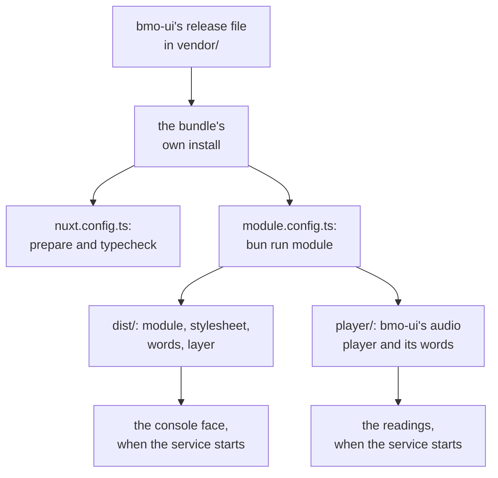

# Layout: bmo-artifact

## Root

The root holds one Rust crate and one console bundle. The bundle sits in its own subfolder.

- **No repeated name.** The repository's folder is already named for what it is, so no folder inside
  it repeats that name.
- **One manifest at the root.** `Cargo.toml` is the only manifest there. The bundle's manifest lives
  under `client/`, one level down.

```
Cargo.toml
VERSION
LICENSE
README.md
CLAUDE.md
build.rs
rustfmt.toml
settings.toml
settings.local.toml.example
testbed.toml
src/
  lib.rs
  bin/
    bmo-artifact.rs        the one binary: its line built from every registered command
  commands/                serve, migrate, health, openapi, mcp, nouns, version, html-read and console-reach, each registered beside its run
  settings.rs              every setting (docs/api.md, "Settings")
  pool.rs                  connection pools and how a statement is bound and run on them
  wire.rs                  the members, bodies and queries the routes answer and take
  openapi.rs               the OpenAPI document, gathered from every route and tool linked in
  client.rs                the service's own Rust client, one method a route
  events.rs                the event kinds and the publisher every change goes through
  reader.rs                the page reader, over bmo-explorer's client
  accounts.rs              the account service, over bmo-web's client: the units a reader stands under, a company and its tree
  wording.rs               the document wording file and its English default
  design.rs                the document design read from client/design/document.json, and a page's sheet
  console.rs               the declaration and bundle folder the console face is built from, and how a deployment reaches it
  player.rs                bmo-ui's audio player script and its words, read from the player folder
  plumbing/                routes, commands, refusals, the bearer check and each route's OpenAPI operation
  store/                   the statements on the document tables, by resource, and the clock their columns keep
    migration/             the migrations and the migrator
  kinds/                   the catalogue, and the five kinds: search, record, learning, import, page
  documents/
    filing.rs              a document filed and rewritten: its row, body, references and file
    keeper.rs              a file kept beside a document, read for what it is
    page_reading.rs        an HTML page read for its title, description and words; a markdown body's description
    import.rs              a page imported whole through the page reader
    preview.rs             the previews and pictures of the pages a document refers to, kept under the file root
    cover.rs               a document's cover picture
    ground.rs              a picture laid on white where its transparency would be lost, and a link's card picture
  http/                    one module a resource, each route registered beside its answer
    files.rs               a kept file sent as kept or as a hosted page, under its isolation
    readers.rs             who a call reads for, and which documents that reader reaches and keeps
    hosted_page.rs         the sandboxed HTML page, its prelude and its bridges
  mcp/                     the MCP server and its tools, each registered beside its call
  helpers/                 the answer ceiling, a line's marks filled in, and a picture read and kept as AVIF
lang/
  documents.en.yaml        the document wording file's English default
skills/
  bmo-artifact/SKILL.md   the harness plugin's skill
tests/
client/                    the console bundle (see "The console bundle")
  package.json
  bun.lock
  nuxt.config.ts           the Nuxt app the sources are prepared and type-checked in
  module.config.ts         the build of the browser module
  module/                  the module's entry, its stylesheet's entry and what stands in for Nuxt's build there
  dist/                    the module's build, which git ignores
  player/                  the audio player's script and words the same build writes, which git ignores
  i18n/                    the bundle's words, one pack a locale
  vendor/                  the bmo-ui release file the bundle's own install takes
  patches/                 bmo-ui's patches to its dependencies, applied in this install
  design/                  the document design the server and the bundle both read
    document.json          the palettes, the page sheet's rules and which pictures open the viewer
    hosted-page.json       the sandbox a kept page runs in and the rest of the policy it is sent under
    bridges/               the clipboard, link, picture, scheme and sound scripts written ahead of a kept page
  app/
    pages/artifact/        the front page and the list, one document, and one shared document
    components/            the front page's parts, and the document body, its text, attachments, references, pictures and page frame
    domain/                the service's calls through the relay, what a screen reads off a document, the text's reading
    assets/css/            the masthead's and the text's stylesheets
  shared/                  the generated API types, the head a share link previews by, and the design files read
  tests/
deploy/
  bmo-artifact.service     the neutral service unit template
```

## Plumbing

The plumbing is what every command and every route stands on, and it knows none of them.

- **Each command registers itself** beside its own run, under the words a caller runs it by. The binary
  builds its command line from every command linked in, and refuses to start where two claim one name.
- **A command** answers the lines it prints, or a refusal said in its own sentence; the binary prints the
  lines on standard output and a refusal on standard error, and ends 0 or 1.
- **The shell** a command stands on is its settings, the database they name, opened on the first
  statement asked of it and settled before the first statement on the document tables, and the
  document wording they name, read when the shell is made. `nouns` stands on none: it is answered
  before the shell is made, so `bmo`'s question reaches the binary run from any directory.
- **A route** declares its method, its path, its answer and its OpenAPI operation: its parameters, its
  body, its answers and the codes it can refuse with. It also declares how far the console's token reaches
  it: not at all, as a share read or the share head, or as a screen's call; the console face's guard holds
  the console's calls to the routes it reaches. Adding a route changes no file but its own; the router and the OpenAPI document gather every route
  linked in, and the server refuses to start where two name one method and path.
- **A call** carries the request and what the server stands on: the settings, the database, the wording,
  the page reader, the preview cache and the event publisher. A route reads its path's keys, its query and
  its JSON body each as its own type, and a request not of that shape is refused `bad-request`.
- **Every call presents a bearer token** the settings name, the service's or the console's, the console's only
  while a console face stands; a route answers only past that check and, for the console's, past the face's
  guard and the reach the route declares. The face's own routes stand beside the router, behind the face's
  guard alone. A method and path no route
  answers is `no-route`.
- **A refusal** is a status and an English sentence, answered with the code bmo-chat's conventions give
  that status. A failure of the database is one: status 500, `failed`.
- **Each harness tool registers itself** beside its call; the MCP server lists them and the OpenAPI
  document states them, by name.
- **The page reader is an interface,** so a test hands the server a reader of its own and reaches no
  network.

## The console bundle

`client/` is a Bun project of its own, the document screens as a console bundle by bmo-ui's console plugin
contract (bmo-ui's `docs/console-bundles.md`). What the service answers of it is docs/api.md, 「The console」.



- **The browser module.** `bun run module` builds `module/entry.ts`, whose default export is the routes of
  the three screens, with bmo-ui's bundle build (bmo-ui's `docs/boundary.md`, 「The bundle build」). It
  writes one ECMAScript module, `dist/bundle.js`, its stylesheet, `dist/bundle.css`, its words,
  `dist/words.json`, each locale's pack under its code, and the layer file the bundle build writes. The
  libraries the bundle shares with its console are the ones bmo-ui's bundle build leaves unbundled; the rest,
  marked and DOMPurify among it, is carried in the module.
- **The player folder.** The same build writes bmo-ui's audio player script, `player/bmo-audio-player.js`,
  copied as the release carries it, and the player's words, `player/words.json`, each locale's
  `artifact.player` words of the pack under its code, in the folder `player` beside the bundle folder: a hosted page loads them
  through the readings (docs/api.md, 「Readings」), and the console face answers only the bundle.
- **What Nuxt's build would supply** is supplied by the module's build: the Vue and Nuxt functions a file
  uses without importing them are imported from `vue` and `nuxt/app`, a component a template names is
  imported from its file, the bundle's own, Nuxt UI's or bmo-ui's, the link component is made from the
  console's Nuxt app, and a page's meta is stated on its route.
- **The stylesheet** is the bundle's own sheets and the utility classes its files use, built against bmo-ui's
  stylesheet without carrying it. The classes its own sheets declare for a document's ground and masthead are
  named under the bundle's name, `artifact-`, so no rule a console keeps under a name of its own reaches them:
  a console's sheets stand above a bundle's, and a rule of the same name there would win.
- **The Nuxt app** in `nuxt.config.ts` extends bmo-ui with the bundle's pages, components and stylesheets, so
  the sources are prepared and type-checked as a console runs them. Nothing is built from it.
- **bmo-ui is one release,** the one bmo-chat's shared versions pin (bmo-chat's `docs/conventions.md`,
  「Shared versions」). The bundle's own install takes it as a development dependency from the file bmo-ui's
  release verb wrote, kept under `client/vendor/` by its own name and bytes; moving to another release
  replaces the file and the line together. bmo-ui's patches under `client/patches/` apply in this install.
- **Under the console's title bar.** The list's and one document's routes ask for the console's bar in their meta,
  so a console that offers its bar (bmo-ui's `docs/console-bundles.md`, 「How a bundle mounts」, the title bar) draws
  it over them under the manifest's title and icon, and they draw no bar of their own. Found without that offer each
  draws its own bar, holding the screen's name and mark alone. A screen lays nothing into either bar: what acts on it
  and its way back stand in its own row directly under the bar (bmo-ui's `docs/console-bundles.md`, 「The screen's
  own row」), the list's toolbar and a document's row (`docs/artifact.md`, 「Where a person reads it」), the same row
  under the console's bar and under its own. The shared document's screen stands under no bar either way.
- **Names.** Every component is named with the prefix `Artifact`, every word is a key under `artifact.`
  in the bundle's own pack beside the `common.*` keys the console answers for bmo-ui, and every page
  stands under `/artifact`: the list, one document at `/artifact/<id>`, and one shared document at
  `/artifact/share/<token>`.
- **Calls.** A screen calls this service's routes at the address bmo-ui's `relay` module answers for the
  service `artifact`, through the app's fetcher, and the console's translator through bmo-ui's `translation`
  module (docs/api.md, 「What this service calls」), and nothing else. That address stands under the console
  app's base path, so a picture, a file or a frame the browser loads by its address reaches the relay as a
  call does. The types it reads are generated from `docs/openapi.json` into `shared/openapi.ts` by the `api`
  script.
- **A document's text is drawn by the bundle.** The service answers a markdown document's file as filed;
  the bundle's reading, built on marked and cleaned by DOMPurify, turns it into HTML: a heading takes its
  contents mark, a picture or a link naming a kept file by its name is drawn from it or goes to it, a
  picture of any other address is a link, a footnote mark is raised and brings its source entry
  forward in a popover or a dialog (`docs/artifact.md`, 「How a document is drawn」), and bmo-ui's code modules colour code, give fenced blocks their
  copy button and draw diagrams. The reading is loaded in the browser alone, since DOMPurify cleans
  against a real document.

## Storage

- **Database.** PostgreSQL, at the address the settings name. The document tables, `imports` and
  `events` are this repository's own (`docs/artifact.md`, "Where it lives").
- **Schema.** The migrations run in order: the document tables in the shape the earlier archive declares
  them; the research profiles' table, then the pair that makes and takes away two tables no longer this
  repository's; the redesign, which adds a document's scope, actor, labels, description and change time,
  an attachment's role, and the imports and events; the research profiles' table taken away; the notes ended
  share links leave; the member shares; the owners and the unit shares; the reads; and when each read was last
  opened, a read kept before standing at the start of its day. A
  migration a database may already have run is never rewritten or removed, since the migrator refuses a
  database whose record names a migration it does not know. `bmo-artifact migrate` brings the database
  the settings name up to date.
- **Settling** happens once in each process, before the first statement on the document tables
  (`docs/artifact.md`, "The tables"). `migrate` does not settle, since it may run before the tables exist.
- **Statements** bind each number at its widest width, so the driver never refuses a statement it has
  prepared because a value comes in a different width; a statement prepared before a table's shape changed
  under the process is run once more on a fresh connection.
- **File root.** The folder holding `searches/<document id>/` and `web-cache/` is a setting.

## Version

- `VERSION` at the root holds the version string; `Cargo.toml` and `client/package.json` both mirror it.
  `build.rs` embeds it into the binary and fails the build where `Cargo.toml` disagrees with it.
- It is numbered as bmo-chat's `docs/conventions.md` says (「Versions」): before the first release
  `0.1.0`, then `0.1.0-rev.<n>`, one revision a version bump, whatever the change.

## The deploy declaration

`testbed.toml` at the root is the declaration bmo-testbed reads. It names:

- how the suite runs: the Cargo package's tests, and the install a fresh tree's console bundle needs
  before its check runs;
- no static step of its own: the testbed's Cargo workspace check formats and lints the crate in the
  shared build directory wherever a change marks it, and its change check compiles every crate a change
  marks (bmo-testbed's `docs/checks.md`);
- the quick checks for the layout, the dependencies and the shared versions, with the base libraries,
  bmo-console-face, bmo-explorer and bmo-web's client allowed, and bmo-chat's shared versions as the ones held to;
- the test database: the migration files that name its template, and the `migrate` command that makes it;
- the one binary a release carries;
- the steps before the flip: the document tables brought to the schema the release carries, and the console
  bundle's module and the player folder built in the release, into the folders the settings name by default;
- the console probe a deployment runs once the service answers (bmo-testbed's `docs/deploy.md`, 「The console
  probe」), reached through `bmo-artifact console-reach`, which prints the address, the console's token and
  the service's token the release's settings name;
- the deployment: the deploy tree under `~/.local/share/bmo-artifact`, the data root it shares with the
  services whose files stand under it, the link that gives a release its local settings, the one unit,
  and the health a deployment waits on.

The service is one unit, `deploy/bmo-artifact.service`, started as `bmo-artifact serve` and marked `bot`:
a deployment links and enables it, restarts it, and is up once `bmo-artifact health` answers ready on the
address the settings name. A stop ends the event streams and lets the calls under way finish,
and the unit waits for the service to end however long that takes, never escalating the stop to a kill. A
release reads its own values from `settings.local.toml`, a link into the data root's `env/artifact.toml`, so
the deployment's backup carries them. A backup of this unit must include the document tables, `imports`,
`events` and the `searches/` folder under the file root; the whole-data-root backup and its restore drill
belong to the testbed.

## Tests

- **Server.** The Rust tests live in `tests/`; no test module stands in `src/`. They are one test target,
  `tests/main.rs`, each file of tests a module of it (bmo-chat's `docs/conventions.md`, 「Rust builds」), but
  the plumbing's: its stand-in verbs and routes register themselves in the process, so they stand in a target
  of their own, `tests/plumbing/main.rs`.
- **Routes.** A route test stands the router up over a scratch PostgreSQL database and a file root of
  its own, with a page reader the test fills, and calls it as a caller would, token and all.
  - The scratch database is made on the server `BMO_TEST_POSTGRES` names, else the local socket's
    `bmo_test`: the first test of a binary migrates a template with this repository's migrator, and
    each test gets a copy of it. A template is named `bmo_artifact_test_tmpl_` followed by the binary's
    process id, a copy `bmo_artifact_test_copy_` followed by the process id and a count.
  - A copy is dropped when its test ends, and the test fails if the drop does: the drop first ends the
    suite role's own sessions on the database and then drops it without forcing, since forcing needs
    the right to end other roles' processes, an autovacuum worker's among them, which the suite's role
    need not hold, while the plain drop stops an autovacuum worker itself.
  - Before a binary makes its first database it drops every template and copy whose process no longer
    runs on this machine and that no session is on, so a binary that ended or was killed leaves nothing
    behind past the next run. The sweep reads these two names and the two a checkout behind this rule
    still makes them under, `bmo_rs_tmpl_` and `bmo_rs_copy_`, and no other.
  - Where the readers' units count, a stand-in account service listens on a port of the test's own, answering
    the two reads this service makes from the users and units the test places, and the settings name it.
- **The MCP server** is started as a harness starts it and held to its twelve tools; one test reaches a
  listening service through it, and one publishes a document from a file.
- **The console face** is stood up over a bundle folder of the test's own holding a module, a stylesheet,
  words and the layer of the bmo-ui release `client/vendor/` holds: the manifest it serves is read through
  bmo-chat's face reading over that release file and names that layer and this service's declaration, and
  the console's token is held to the share reads, the screens' routes and the 403 on every other route. The
  face's own guard is the face's tests'.
- **The OpenAPI document** committed is held to what the code generates.
- **Repository checks.** Tests in `tests/` also hold the repository to its rules: no Hangul outside the
  bundle's language pack, no personal data in any tracked file (`PERSONAL-DATA.md`), no folder named after
  its parent, Cargo's manifest as the only manifest at the root, no test module in `src/`, and the dependency
  check below.
- **Client.** The bundle's tests live in `client/tests/`, every one run with happy-dom's document
  registered. The bundle's `check` script runs its typecheck and its tests, and is what the testbed runs
  for it as a project of its own. The files under `client/tests/browser/` drive a real Chromium through
  playwright-core, and are skipped where the browser it pins is not on the machine. A test that drives the
  screens themselves stands them on the host under `client/tests/browser/host/`, the client's layer under a
  page shell of its own in a dashboard group, as a console stands a bundle's screens, served by Nuxt's dev server in
  a process group of its own that the test takes down, loaded once before any test drives them so no test waits on
  their first compile, and answers the service's routes from a stand-in in front of the page.

## Dependency check

- **Allowed.** `Cargo.toml` and `client/package.json` may name `bmo-chat`, `bmo-chat-client`,
  `bmo-console-face` and `bmo-ui` among internal dependencies, and the published clients of the units this
  service calls, `bmo-explorer` and bmo-web's `bmo-web-client`; `bmo-console-face`, `bmo-explorer` and
  `bmo-web-client` are taken from their checkouts beside this repository's. No other `bmo-*` package.
- **Enforced.** A test in `tests/` fails the moment any other internal name appears in any `Cargo.toml` or
  `package.json` of the repository, or as the first segment of a path in a Rust file. A manifest's path
  dependency that reaches outside the repository fails it too, but for those two. The same test holds
  `client/package.json` to taking bmo-ui for its own install from a file inside the repository.
- **Other units.** Every other unit is reached through the calls `docs/api.md` lists.
