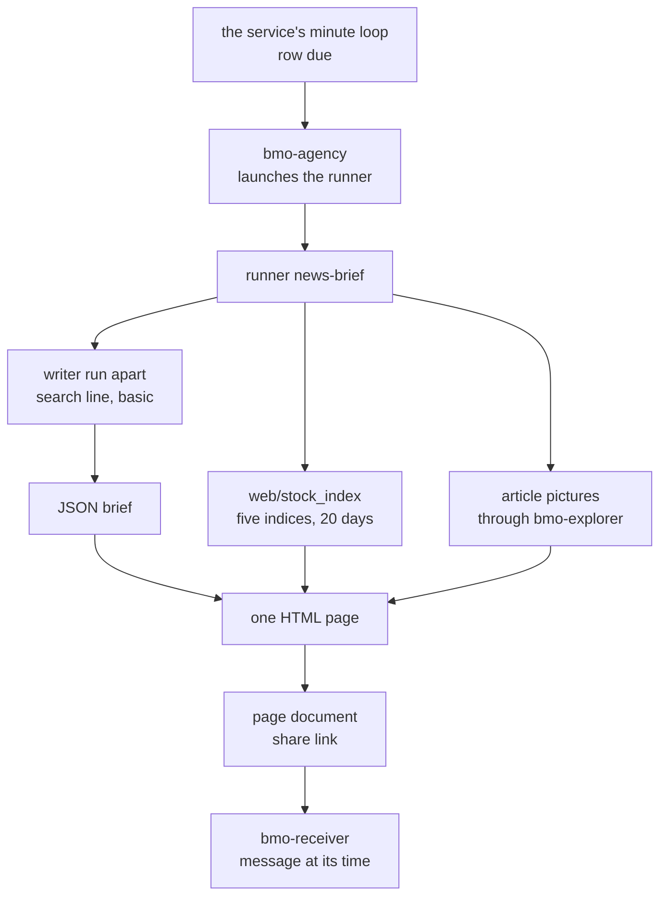

# The morning news page

## What it is

- **One page a working morning, sent to a room as a link.** The page holds the day's news in about
  ten short cards, a summary of a few lines above them, and three fixed sections: the home stock
  market, the US stock market and the home property market. The room gets the link first, then the
  page's title and the summary.
- **The message reads the same in every room.** The link, the title and the summary each stand
  apart with a blank line between them, and every summary line opens with a `•`. The bullet is a
  character, not a mark: a room that shows no formatting sends what it is handed as it stands, so
  the message carries no markdown for any room to render or strip.
- **Every line on it is written, not copied.** The writer reads each article it uses and says what
  happened in its own words, under a title of its own; a headline or a lede pasted and trimmed is
  what the page exists not to be.
- **Every figure on it is read, not written.** The index levels, their changes and the charts come
  from the `stock_index` site tool's reading, drawn by the page itself. The writer explains the
  session and names the stocks that moved; it never types an index level.
- **It is this repository's because it is a page and a share link.** The page is filed as a page
  document and handed over by a share link, the writer is a research run on the search line, and
  its pictures are fetched the way a search's are: everything it is made of is already this
  repository's own, and nothing else uses what it adds.

## How one page is made

- **The runner's run has a row in bmo-agency's run ledger.** The row is opened before the runner is
  launched, and the runner closes it with how it ended: `done`, or `failed` with the room sent
  nothing. A row whose runner never came up is closed `error` by whoever asked for the launch.
- **The writer is a research run apart** on the search line and the `search:basic` research
  profile: the same tools, the same site tools and the same model the profile sets for a basic
  search.
  - Its instructions are the news task in place of the search's, which bmo-agency composes for the
    line by the name `news-brief`, with the line's tools and rulebooks.
  - Its prompt is the prompt tree's `agents/search/news-brief-request.md`, filled with the day the
    page is for and the moment it is written.
  - It opens no branch.
- **Its answer is one JSON object**: the summary lines, the items (tag, title, lines, the article's
  address and its picture's address), and for each fixed section its lines and sources, with the
  movers for the two market sections. An answer that is not that object, or breaks its limits, is no
  page: the run fails and the owner is told.
- **The runner draws everything else.**
  - It reads the KOSPI, the KOSDAQ, the Dow Jones, the S&P 500 and the Nasdaq Composite for their
    last twenty closes from the `stock_index` site tool, through the tool host.
  - It fetches each article's picture, the one the writer named or else the article page's own
    `og:image`, through bmo-explorer, and cuts it to the card as a small JPEG carried inside the
    page.
  - It renders the page.
  - A picture or an index that could not be had leaves its place plain rather than stopping the
    page, and the runner says which on its error stream.
- **Every outward read goes through bmo-explorer.** The address checks, the pacing per host and the
  bounds on what is read are bmo-explorer's. One run's reading is paced together under one pacing
  name.
- **The page is filed** as a page document of the room it is for, and a share link is made for it
  that lives the row's share hours. The page and the writer's answer are also kept as files of the
  day under `news-brief/` in the file root, beside `searches/`, so a failed morning can be read back.
- **The message waits for its time.** Writing starts the row's lead before its time; a page ready
  early is held and sent through bmo-receiver at the minute the row names.
- **A run that fails tells the owner.** A quiet instruction goes to the deployment's agent in the
  owner's private chat, naming the day, the room and what failed, and the room is sent nothing that
  day.

## When it runs

- **Each room is a row of `news_briefs`**: the room, the time the page is sent, how long before it
  the writing starts, how long the link lives, whether it is on, the day it last started, and when
  the row was made.
- **A row runs on working days only**: Monday to Friday, and not on a day the `holidays` table
  holds.
- **Days and times are told in the time zone the settings name** (`zone` under `[time]`).
- **The service looks every minute.** The look is a loop inside the service's own server process,
  registered beside the news brief's own code, so the server starts it with every other loop and
  stops it when the service stops.
  - A row is started once a day, from its lead before its time until two hours after it.
  - The day is written on the row as it starts, so a restart that morning does not send it twice,
    and a service that was down all morning leaves the day unsent rather than sending it at noon.
  - A row is started as `news-brief --run` starts one: its run's row opened in bmo-agency's ledger
    and its runner launched by bmo-agency.
- **A new row starts off.** A room begins receiving pages when it is switched on, after a trial run
  has been sent somewhere and looked at.

## The holiday calendar

- **`holidays` holds one row per day off**: the day and its name. The lunar holidays, the
  substitute days and the temporary holidays a government announces are not computed: each year is
  added through the command. The repository seeds no row of either table; a deployment's rows stand
  in its database.
- **A year the table holds nothing of** cannot tell a holiday from a working day. The pages still go
  on weekdays, and the owner is told, once for that year while the service runs and only while a row
  is on, through the same quiet instruction a failed run sends, that the calendar is empty for it.

## The commands

- **`news-brief`** lists the rooms and how many holidays this year and the next hold.
  - `--add --chat <chatId> [--at HH:MM] [--lead <minutes>] [--share-hours <n>] [--on]` adds a room,
    off unless `--on` says otherwise; the defaults are 08:30, forty minutes and twenty-four hours.
  - `--set <id>` changes any of those; `--on <id>` and `--off <id>` switch a room; `--remove <id>`
    takes it away.
  - A time not written `HH:MM`, a lead outside 10 to 180 minutes, share hours outside 1 to 720 and a
    room not named by its chat id are refused before anything is written.
  - `--run <id> [--send-to <chatId>]` makes today's page at once, exactly as that room would get it,
    and sends it to `--send-to` where one is named, which is what a trial is. It opens the run's row
    in bmo-agency's ledger, has bmo-agency launch the runner, and answers with the run and its unit.
  - `--holidays [<year>]`, `--holiday-add YYYY-MM-DD '<name>'` and `--holiday-remove YYYY-MM-DD`
    read and edit the calendar.
  - Its answers are English lines.
- **`runner news-brief`**, also run as `news-brief-runner`, is the run bmo-agency launches. It takes
  the room, the day, the share hours and the send time directly, as `--chat`, `--day`,
  `--share-hours` and `--send-at`, with `--send-to` for a room the message goes to instead and
  `--run` for the ledger row it closes.
  - `--answer <file>` draws the page from an answer already written, and `--no-send` stops once the
    page file is drawn, filing and sending nothing.
  - It runs where it is started and launches nothing of its own.

## The page

- **One column, light, for a phone.** The summary stands in a coloured box at the top; each card
  carries its picture on the left, its field, its number, its title, two or three lines and the
  outlet it came from as the link. Each market section shows its indices side by side where there is
  room (the close, the change with a red or blue mark, and the twenty-day line), then its lines, the
  movers and its sources.
- **It carries everything it draws**: the pictures are inside it and the charts are SVG, so the page
  opens the same next week as this morning. The one thing it asks the web for is the Pretendard font.
- **Every word a person reads on it** — the day, the title, the section headings, the index names,
  the labels — comes from the `news_page` keys of the document wording file (`docs/api.md`,
  "Wording"), and so does the message's title line.
